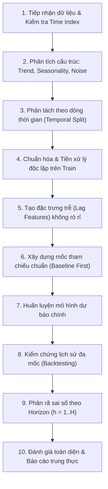
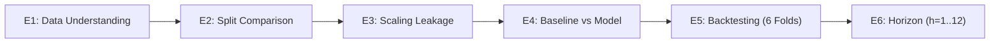

<div align="center">

# ⏱️ TOPIC 5: ĐÁNH GIÁ MÔ HÌNH DỰ BÁO ĐÚNG CÁCH
### DATA LEAKAGE VÀ BACKTESTING TRONG CHUỖI THỜI GIAN


<br/>


<br/>


</div>

---

# 📖 Giới thiệu Chuyên đề

Thư mục **`Presentation-24.10.2026`** là công trình chuyên đề nghiên cứu và thực nghiệm thuộc **Topic 5 — Đánh giá mô hình dự báo đúng cách: Data Leakage và Backtesting** (theo tài liệu chỉ đạo [Time Series.pdf](file:///d:/Documents/Coding/TOTAL_LAB_PRACTICE_FOR_TIME_SERIES/references/Time%20Series.pdf)).

Mục tiêu trọng tâm của dự án không phải là chạy đua tìm kiếm các mô hình máy học/Deep Learning phức tạp, mà là **xây dựng phương pháp luận đánh giá khoa học, trung thực, không bị sai lệch (unbiased)**:

- **Phân định ranh giới thời gian**: Hiểu rõ vì sao các phương pháp Machine Learning truyền thống (như Random Split) gây sụp đổ mô hình khi triển khai dự báo tương lai.
- **Nhận diện và phòng chống Data Leakage**: Đặc biệt là hiện tượng rò rỉ thông tin tương lai trong khâu tiền xử lý (Scaling Leakage).
- **Kiểm định độ bền vững qua Backtesting**: Áp dụng Expanding Window và Rolling Window để đo lường độ ổn định qua nhiều mốc lịch sử thay vì chỉ dựa vào một lần cắt train/test duy nhất.
- **Baseline First**: Luôn thiết lập các mốc tham chiếu cơ bản (Naive, Seasonal Naive) làm mốc chuẩn tối thiểu để chứng minh giá trị thực của mô hình có học.
- **Phân rã sai số theo Forecast Horizon**: Đo lường sự tích tụ sai số qua từng bước cự ly dự báo $h = 1, 2, \dots, H$.

> 💡 **Triết lý thực thi**: *"Mặc định không có nghĩa là tệ hại"* — Mã nguồn được tinh gọn tối đa, sử dụng chuẩn mực trực quan hóa quốc tế, và toàn bộ kết quả thực nghiệm được điều khiển đồng bộ qua một file Jupyter Notebook duy nhất: [Presentation_practice.ipynb](file:///d:/Documents/Coding/TOTAL_LAB_PRACTICE_FOR_TIME_SERIES/Presentation-24.10.2026/notebooks/Presentation_practice.ipynb).

---

# 🎯 4 Trụ cột Nghiên cứu & Thực nghiệm

<table>
  <tr>
    <td align="center" width="25%">
      <h3>🧠 Hiểu (Understand)</h3>
      Bản chất bài toán dự báo là đoán tương lai chưa biết. Hiểu cơ chế Optimistic Bias khi xáo trộn thời gian và sự sai lệch phân phối khi chuẩn hóa rò rỉ dữ liệu.
    </td>
    <td align="center" width="25%">
      <h3>🔍 Phân tích (Analyze)</h3>
      Đối chứng định lượng giữa Random vs Temporal Split, Pipeline A (Leakage) vs Pipeline B (Correct), và phân tích sai số theo bước chân trời dự báo $h=1..12$.
    </td>
    <td align="center" width="25%">
      <h3>🛠️ Xây dựng (Build)</h3>
      Thiết lập pipeline cách ly 100% giữa train và validation, xây dựng bộ mốc Baseline (Naive, Seasonal Naive) và mô hình hồi quy cuốn chiếu (Recursive Forecaster).
    </td>
    <td align="center" width="25%">
      <h3>📈 Đánh giá (Evaluate)</h3>
      Kiểm chứng lịch sử đa mốc qua Expanding Window Backtesting 6 folds, đánh giá đồng thời bằng bộ ba chỉ số MAE, RMSE, MAPE và tỷ lệ cải thiện tương đối.
    </td>
  </tr>
</table>

---

# 📊 Hồ sơ Dữ liệu Thực nghiệm (Dataset Profile)

Toàn bộ 6 bài thực nghiệm được thực hiện trên chuỗi thời gian kinh điển **AirPassengers** (`datasets/raw/air_passengers.csv`), đại diện hoàn hảo cho chuỗi thời gian có xu hướng tăng trưởng dài hạn kết hợp với dao động mùa vụ mạnh mẽ:

<table>
  <tr>
    <th align="left">Thuộc tính</th>
    <th align="left">Giá trị định lượng thực tế</th>
    <th align="left">Ý nghĩa khoa học đối với Topic 5</th>
  </tr>
  <tr>
    <td><b>Dataset</b></td>
    <td><code>AirPassengers</code></td>
    <td>Dữ liệu lượng hành khách hàng không quốc tế (nghìn người)</td>
  </tr>
  <tr>
    <td><b>Khoảng thời gian</b></td>
    <td><code>1949-01-01</code> đến <code>1960-12-01</code></td>
    <td>Tròn 12 năm lịch sử liên tục không ngắt quãng</td>
  </tr>
  <tr>
    <td><b>Số quan sát</b></td>
    <td><code>144</code> tháng</td>
    <td>Đủ dài để chia 6 folds kiểm chứng đa mốc (mỗi fold 1 năm)</td>
  </tr>
  <tr>
    <td><b>Tần suất (Frequency)</b></td>
    <td>Hàng tháng đầu kỳ (<code>MS</code>)</td>
    <td>Nhịp thời gian đều đặn, chỉ số trễ lag mang ý nghĩa chu kỳ tháng</td>
  </tr>
  <tr>
    <td><b>Seasonal Period ($m$)</b></td>
    <td><code>12</code> tháng</td>
    <td>Chu kỳ mùa hè bùng nổ, dùng để kiểm định Seasonal Naive</td>
  </tr>
  <tr>
    <td><b>Missing / Duplicates</b></td>
    <td><code>0</code> missing values, <code>0</code> duplicate</td>
    <td>Chuỗi thời gian sạch, bảo toàn thứ tự đơn điệu tăng dần 100%</td>
  </tr>
  <tr>
    <td><b>Khoảng giá trị</b></td>
    <td>Min: <code>104.0</code> — Max: <code>622.0</code></td>
    <td>Biên độ dao động tăng dần theo thời gian (Multiplicative trend)</td>
  </tr>
</table>

---

# 🗂️ Cấu trúc Thư mục Dự án

```text
Presentation-24.10.2026/
├── README.md                      # Báo cáo tổng quan dự án Topic 5
├── pyproject.toml                 # Cấu hình môi trường Python 3.12 & dependencies
├── config/
│   └── presentation_config.json   # Cấu hình tập trung cho toàn bộ E1..E6
├── datasets/
│   ├── README.md                  # Hướng dẫn dữ liệu thô bất biến
│   ├── raw/                       # Dữ liệu gốc (air_passengers.csv)
│   └── processed/                 # Dữ liệu trễ và fold chia tách
├── docs/
│   ├── theory/                    # 10 bài nghiên cứu lý thuyết chuyên sâu chuẩn 5W1H
│   ├── plans/                     # Master experiment plan và 6 plans chi tiết E1..E6
│   └── status/
│       └── current_status.md      # Trạng thái hiện tại: 100% Completed & Delivered
├── notebooks/
│   └── Presentation_practice.ipynb # File Notebook tâm điểm duy nhất của thuyết trình
├── outputs/
│   ├── figures/                   # 7 visual artifacts xuất bản theo chuẩn quốc tế
│   └── results/                   # 9 bảng số liệu CSV trích xuất từ thực nghiệm
├── src/
│   └── presentation_24_10_2026/   # Package mã nguồn nghiệp vụ chuẩn modular
│       ├── data/                  # Loader, Time index validator & Temporal Split
│       ├── preprocessing/         # Scaling modules (Pipeline A Leakage vs Pipeline B Correct)
│       ├── models/                # Baseline (Naive, Seasonal Naive) & Recursive Forecaster
│       ├── evaluation/            # Backtesting (Expanding/Rolling), Horizon matrix & Metrics
│       └── visualization/         # 7 hàm vẽ đồ thị sans-serif chuẩn mực, no bold, tiếng Anh
└── tests/                         # 9 ca kiểm thử đơn vị bảo vệ tính đúng đắn logic
    ├── test_split.py
    ├── test_scaling.py
    ├── test_baseline.py
    └── test_metrics.py
```

<table>
  <tr>
    <th align="left">Thành phần</th>
    <th align="left">Vai trò trong dự án Topic 5</th>
  </tr>
  <tr>
    <td><code>notebooks/Presentation_practice.ipynb</code></td>
    <td><b>Cỗ máy thực thi duy nhất (Single Execution Engine)</b>: Vừa là tài liệu thuyết trình 5W1H, vừa là driver trực tiếp gọi các hàm trong <code>src/</code> để tính toán, lưu kết quả và render đồ thị.</td>
  </tr>
  <tr>
    <td><code>src/presentation_24_10_2026/</code></td>
    <td>Chứa toàn bộ mã nguồn thuật toán, tách bạch hoàn toàn logic nghiệp vụ ra khỏi giao diện notebook. Tự động cập nhật vào notebook thông qua <code>%autoreload 2</code>.</td>
  </tr>
  <tr>
    <td><code>docs/theory/</code></td>
    <td>10 tài liệu nghiên cứu chuyên sâu trả lời triệt để bộ câu hỏi <b>What - Why - When - Where - Who - How</b> theo chuẩn nghiên cứu khoa học.</td>
  </tr>
  <tr>
    <td><code>docs/plans/</code></td>
    <td>Kế hoạch tổng thể và 6 kế hoạch chi tiết từ E1 đến E6, đã nghiệm thu hoàn thành 100%.</td>
  </tr>
  <tr>
    <td><code>outputs/figures/</code></td>
    <td>Chứa 7 Visual Artifacts (PNG độ phân giải cao) phục vụ trình chiếu slide và báo cáo.</td>
  </tr>
  <tr>
    <td><code>outputs/results/</code></td>
    <td>Chứa 9 bảng số liệu CSV lưu lại toàn bộ kết quả đo lường khách quan từ thực nghiệm.</td>
  </tr>
  <tr>
    <td><code>tests/</code></td>
    <td>Bộ kiểm thử tự động xác thực tính đúng đắn toán học và nguyên tắc không rò rỉ dữ liệu.</td>
  </tr>
</table>

---

# 🔄 Quy trình Đánh giá Chuẩn 10 bước (Correct Evaluation Workflow)

Để bảo đảm tính trung thực và ngăn ngừa mọi sai lệch trong dự báo chuỗi thời gian, dự án tuân thủ nghiêm ngặt quy trình đánh giá 10 bước:



---

# 🧪 Chuỗi 6 Thực nghiệm Thực tế (E1 đến E6) — Kết quả & Bằng chứng

Toàn bộ 6 thực nghiệm đã được chạy thực tế, lưu số liệu và nghiệm thu hoàn tất:



<table>
  <tr>
    <th align="center">Mã</th>
    <th align="left">Nội dung thực nghiệm</th>
    <th align="center">Chỉ số thực tế thu được</th>
    <th align="left">Kết luận khoa học rút ra</th>
    <th align="center">Artifact</th>
  </tr>
  <tr>
    <td align="center"><b>E1</b></td>
    <td><b>Data Understanding & Time Index</b><br/>[e1_plan](file:///d:/Documents/Coding/TOTAL_LAB_PRACTICE_FOR_TIME_SERIES/Presentation-24.10.2026/docs/plans/e1_data_understanding_plan.md)</td>
    <td align="center">144 tháng, <code>freq=MS</code><br/>Min=104, Max=622<br/>Missing=0</td>
    <td>Trục thời gian đơn điệu tăng dần 100%, không bị gián đoạn, đủ điều kiện để tạo lag an toàn.</td>
    <td align="center"><a href="file:///d:/Documents/Coding/TOTAL_LAB_PRACTICE_FOR_TIME_SERIES/Presentation-24.10.2026/outputs/figures/01_time_series_overview.png">Visual 1</a></td>
  </tr>
  <tr>
    <td align="center"><b>E2</b></td>
    <td><b>Random Split vs Temporal Split</b><br/>[e2_plan](file:///d:/Documents/Coding/TOTAL_LAB_PRACTICE_FOR_TIME_SERIES/Presentation-24.10.2026/docs/plans/e2_split_comparison_plan.md)</td>
    <td align="center">Random: MAE=13.85<br/>Temporal: MAE=14.13</td>
    <td>Random Split tạo ra Optimistic Bias do nhìn trước điểm lân cận ($t-1, t+1$), biến dự báo thành nội suy.</td>
    <td align="center"><a href="file:///d:/Documents/Coding/TOTAL_LAB_PRACTICE_FOR_TIME_SERIES/Presentation-24.10.2026/outputs/figures/02_random_vs_temporal_split.png">Visual 2</a></td>
  </tr>
  <tr>
    <td align="center"><b>E3</b></td>
    <td><b>Scaling Data Leakage</b><br/>[e3_plan](file:///d:/Documents/Coding/TOTAL_LAB_PRACTICE_FOR_TIME_SERIES/Presentation-24.10.2026/docs/plans/e3_scaling_leakage_plan.md)</td>
    <td align="center">Pipeline A: $\mu=291.89$<br/>Pipeline B: $\mu=254.26$</td>
    <td>Fit scaler trên toàn chuỗi làm lệch tham số $\mu$ tới $+37.63$ đơn vị do nhiễm trend tương lai.</td>
    <td align="center"><a href="file:///d:/Documents/Coding/TOTAL_LAB_PRACTICE_FOR_TIME_SERIES/Presentation-24.10.2026/outputs/figures/03_scaling_leakage_comparison.png">Visual 3</a></td>
  </tr>
  <tr>
    <td align="center"><b>E4</b></td>
    <td><b>Baseline vs Forecasting Model</b><br/>[e4_plan](file:///d:/Documents/Coding/TOTAL_LAB_PRACTICE_FOR_TIME_SERIES/Presentation-24.10.2026/docs/plans/e4_baseline_vs_model_plan.md)</td>
    <td align="center">Naive: MAE=76.00<br/>S.Naive: MAE=47.83<br/><b>Ridge: MAE=14.72</b></td>
    <td>Mô hình máy học cải thiện <b>+80.6%</b> so với Naive và <b>+69.2%</b> so với Seasonal Naive, xác nhận giá trị học máy thực sự.</td>
    <td align="center"><a href="file:///d:/Documents/Coding/TOTAL_LAB_PRACTICE_FOR_TIME_SERIES/Presentation-24.10.2026/outputs/figures/04_baseline_vs_model.png">Visual 4</a></td>
  </tr>
  <tr>
    <td align="center"><b>E5</b></td>
    <td><b>Backtesting (6 Folds Expanding)</b><br/>[e5_plan](file:///d:/Documents/Coding/TOTAL_LAB_PRACTICE_FOR_TIME_SERIES/Presentation-24.10.2026/docs/plans/e5_backtesting_plan.md)</td>
    <td align="center">Mean MAE = 19.01<br/>Mean RMSE = 21.19<br/><b>Mean MAPE = 5.34%</b></td>
    <td>Mô hình kiểm soát sai số phần trăm dưới 10% ở mọi fold, chỉ ra thách thức tại các năm cuối khi biên độ mùa hè tăng vọt.</td>
    <td align="center"><a href="file:///d:/Documents/Coding/TOTAL_LAB_PRACTICE_FOR_TIME_SERIES/Presentation-24.10.2026/outputs/figures/05_backtesting_folds.png">Visual 5</a><br/><a href="file:///d:/Documents/Coding/TOTAL_LAB_PRACTICE_FOR_TIME_SERIES/Presentation-24.10.2026/outputs/figures/06_performance_across_folds.png">Visual 6</a></td>
  </tr>
  <tr>
    <td align="center"><b>E6</b></td>
    <td><b>Forecast Horizon ($h=1..12$)</b><br/>[e6_plan](file:///d:/Documents/Coding/TOTAL_LAB_PRACTICE_FOR_TIME_SERIES/Presentation-24.10.2026/docs/plans/e6_horizon_evaluation_plan.md)</td>
    <td align="center">$h=1$: MAE=13.80<br/>$h=8$: MAE=12.83<br/>Cải thiện: +33%..+75%</td>
    <td>Sai số không tăng tuyến tính mà biến thiên theo nhịp sóng mùa vụ; mô hình vượt trội baseline ở tất cả 12 bước chân trời.</td>
    <td align="center"><a href="file:///d:/Documents/Coding/TOTAL_LAB_PRACTICE_FOR_TIME_SERIES/Presentation-24.10.2026/outputs/figures/07_error_by_forecast_horizon.png">Visual 7</a></td>
  </tr>
</table>

---

# 🖼️ Danh mục 7 Visual Artifacts Xuất bản (outputs/figures/)

Toàn bộ biểu đồ được thiết kế theo chuẩn thẩm mỹ quốc tế: sử dụng hệ font sans-serif (`DejaVu Sans`, `Segoe UI`, `Arial`), bình thường hóa độ đậm (no bold), 100% tiếng Anh khoa học và tự động lưu phân giải cao (`dpi=150`):

<table>
  <tr>
    <th align="center">STT</th>
    <th align="left">Tên File Artifact</th>
    <th align="center">Gắn với</th>
    <th align="left">Ý nghĩa trực quan phục vụ bài thuyết trình</th>
  </tr>
  <tr>
    <td align="center"><b>Visual 1</b></td>
    <td><a href="file:///d:/Documents/Coding/TOTAL_LAB_PRACTICE_FOR_TIME_SERIES/Presentation-24.10.2026/outputs/figures/01_time_series_overview.png"><code>01_time_series_overview.png</code></a></td>
    <td align="center"><b>E1</b></td>
    <td>Trực quan hóa toàn bộ chuỗi thời gian kèm đường Max (622), Min (104) và đường trung bình năm Annual Average (`12x5`).</td>
  </tr>
  <tr>
    <td align="center"><b>Visual 2</b></td>
    <td><a href="file:///d:/Documents/Coding/TOTAL_LAB_PRACTICE_FOR_TIME_SERIES/Presentation-24.10.2026/outputs/figures/02_random_vs_temporal_split.png"><code>02_random_vs_temporal_split.png</code></a></td>
    <td align="center"><b>E2</b></td>
    <td>Sơ đồ Timeline chỉ rõ các điểm dữ liệu tương lai bị lọt vào tập train khi chia ngẫu nhiên vs tính nhân quả chuẩn mực của Temporal Split.</td>
  </tr>
  <tr>
    <td align="center"><b>Visual 3</b></td>
    <td><a href="file:///d:/Documents/Coding/TOTAL_LAB_PRACTICE_FOR_TIME_SERIES/Presentation-24.10.2026/outputs/figures/03_scaling_leakage_comparison.png"><code>03_scaling_leakage_comparison.png</code></a></td>
    <td align="center"><b>E3</b></td>
    <td>Histogram đối chiếu sự biến dạng phân phối chuẩn hóa z-score giữa Pipeline A (Leakage) và Pipeline B (Correct).</td>
  </tr>
  <tr>
    <td align="center"><b>Visual 4</b></td>
    <td><a href="file:///d:/Documents/Coding/TOTAL_LAB_PRACTICE_FOR_TIME_SERIES/Presentation-24.10.2026/outputs/figures/04_baseline_vs_model.png"><code>04_baseline_vs_model.png</code></a></td>
    <td align="center"><b>E4</b></td>
    <td>Đồ thị so sánh đường dự báo: Actual Test vs Naive vs Seasonal Naive vs Forecaster (Ridge + Lags).</td>
  </tr>
  <tr>
    <td align="center"><b>Visual 5</b></td>
    <td><a href="file:///d:/Documents/Coding/TOTAL_LAB_PRACTICE_FOR_TIME_SERIES/Presentation-24.10.2026/outputs/figures/05_backtesting_folds.png"><code>05_backtesting_folds.png</code></a></td>
    <td align="center"><b>E5</b></td>
    <td>Sơ đồ thanh ngang biểu thị cửa sổ Train và Validation qua 6 Folds Expanding Window theo trục thời gian lịch sử.</td>
  </tr>
  <tr>
    <td align="center"><b>Visual 6</b></td>
    <td><a href="file:///d:/Documents/Coding/TOTAL_LAB_PRACTICE_FOR_TIME_SERIES/Presentation-24.10.2026/outputs/figures/06_performance_across_folds.png"><code>06_performance_across_folds.png</code></a></td>
    <td align="center"><b>E5</b></td>
    <td>Đường biểu diễn sự biến thiên sai số MAE của mô hình và baseline qua 6 năm độc lập (1955 đến 1960).</td>
  </tr>
  <tr>
    <td align="center"><b>Visual 7</b></td>
    <td><a href="file:///d:/Documents/Coding/TOTAL_LAB_PRACTICE_FOR_TIME_SERIES/Presentation-24.10.2026/outputs/figures/07_error_by_forecast_horizon.png"><code>07_error_by_forecast_horizon.png</code></a></td>
    <td align="center"><b>E6</b></td>
    <td>Đường biến thiên sai số MAE và RMSE theo từng bước cự ly chân trời dự báo $h=1..12$, làm rõ nhịp sóng mùa vụ.</td>
  </tr>
</table>

---

# 📚 Kho Tài liệu Nghiên cứu Lý thuyết Chuẩn 5W1H (docs/theory/)

10 bài nghiên cứu lý thuyết được đóng gói chuẩn mực trong [docs/theory/](file:///d:/Documents/Coding/TOTAL_LAB_PRACTICE_FOR_TIME_SERIES/Presentation-24.10.2026/docs/theory/):

1. [01_overview_5w1h.md](file:///d:/Documents/Coding/TOTAL_LAB_PRACTICE_FOR_TIME_SERIES/Presentation-24.10.2026/docs/theory/01_overview_5w1h.md): Tổng quan về Đánh giá Dự báo Chuỗi thời gian.
2. [02_random_vs_temporal_split.md](file:///d:/Documents/Coding/TOTAL_LAB_PRACTICE_FOR_TIME_SERIES/Presentation-24.10.2026/docs/theory/02_random_vs_temporal_split.md): Random Split vs Temporal Split.
3. [03_data_leakage.md](file:///d:/Documents/Coding/TOTAL_LAB_PRACTICE_FOR_TIME_SERIES/Presentation-24.10.2026/docs/theory/03_data_leakage.md): Data Leakage trong Time Series.
4. [04_scaling_leakage.md](file:///d:/Documents/Coding/TOTAL_LAB_PRACTICE_FOR_TIME_SERIES/Presentation-24.10.2026/docs/theory/04_scaling_leakage.md): Scaling Data Leakage.
5. [05_backtesting_concepts.md](file:///d:/Documents/Coding/TOTAL_LAB_PRACTICE_FOR_TIME_SERIES/Presentation-24.10.2026/docs/theory/05_backtesting_concepts.md): Khái niệm & Cơ chế Backtesting.
6. [06_rolling_vs_expanding_window.md](file:///d:/Documents/Coding/TOTAL_LAB_PRACTICE_FOR_TIME_SERIES/Presentation-24.10.2026/docs/theory/06_rolling_vs_expanding_window.md): Rolling Window vs Expanding Window.
7. [07_evaluation_metrics.md](file:///d:/Documents/Coding/TOTAL_LAB_PRACTICE_FOR_TIME_SERIES/Presentation-24.10.2026/docs/theory/07_evaluation_metrics.md): Bộ ba chỉ số sai số MAE, RMSE, MAPE.
8. [08_baseline_forecast.md](file:///d:/Documents/Coding/TOTAL_LAB_PRACTICE_FOR_TIME_SERIES/Presentation-24.10.2026/docs/theory/08_baseline_forecast.md): Mốc tham chiếu Baseline Forecast.
9. [09_forecast_horizon.md](file:///d:/Documents/Coding/TOTAL_LAB_PRACTICE_FOR_TIME_SERIES/Presentation-24.10.2026/docs/theory/09_forecast_horizon.md): Đánh giá theo Forecast Horizon.
10. [10_correct_evaluation_workflow.md](file:///d:/Documents/Coding/TOTAL_LAB_PRACTICE_FOR_TIME_SERIES/Presentation-24.10.2026/docs/theory/10_correct_evaluation_workflow.md): Quy trình Đánh giá Chuẩn 10 bước.

---

# 💡 5 Bài học Khoa học Cốt lõi (Key Takeaways)

> ### 1. Tuyệt đối không dùng Random Split cho Chuỗi thời gian
> Dữ liệu chuỗi thời gian sở hữu cấu trúc tự tương quan chặt chẽ. Chia ngẫu nhiên sẽ biến bài toán ngoại suy tương lai thành bài toán nội suy quá khứ, tạo ra sai số thấp giả tạo và khiến mô hình sụp đổ khi vận hành thực tế.

> ### 2. Mọi khâu tiền xử lý chỉ được học trên tập Train
> Scaler, Imputer hay Encoder đều học các tham số thống kê ($\mu, \sigma, \min, \max$). Việc fit trên toàn chuỗi hoặc trước khi chia tập dữ liệu là hình thức "nhìn trộm tương lai" nguy hiểm, bóp méo hoàn toàn phân phối dữ liệu.

> ### 3. Luôn luôn bắt đầu từ Baseline (Baseline First)
> Một mô hình học máy phức tạp không có giá trị nếu không vượt qua được Naive hoặc Seasonal Naive. Baseline là mốc chuẩn khoa học tối thiểu giúp kiểm chứng thuật toán có thực sự học được quy luật hay không.

> ### 4. Backtesting đa mốc là thước đo duy nhất cho độ ổn định
> Một lần cắt Train/Test đơn lẻ chỉ đại diện cho một hoàn cảnh lịch sử ngẫu nhiên. Kiểm chứng đa mốc (Expanding Window / Rolling Window) qua nhiều thời kỳ mới phản ánh đúng độ bền vững và khả năng khái quát hóa của mô hình.

> ### 5. Sai số phụ thuộc vào cự ly dự báo và nhịp mùa vụ
> Không bao giờ giả định sai số luôn tăng tuyến tính theo khoảng cách $h$. Phân rã sai số theo từng bước $h=1..H$ giúp xác định chính xác điểm hội tụ chu kỳ và phạm vi tin cậy tối ưu của mô hình trong thực tế.

---

# 🚀 Hướng dẫn Chạy Thuyết trình

Để trình diễn toàn bộ bài thuyết trình chuyên đề Topic 5, bạn chỉ cần mở file notebook trung tâm:

1. Mở file [Presentation_practice.ipynb](file:///d:/Documents/Coding/TOTAL_LAB_PRACTICE_FOR_TIME_SERIES/Presentation-24.10.2026/notebooks/Presentation_practice.ipynb).
2. Chạy Cell 1 để kích hoạt `%autoreload 2` và nạp toàn bộ cấu hình.
3. Chạy tuần tự các Cell từ Mục 1 đến Mục 8. Toàn bộ bảng số liệu và 7 đồ thị Visual Artifacts sẽ được tính toán trực tiếp và hiển thị sắc nét trên màn hình!
