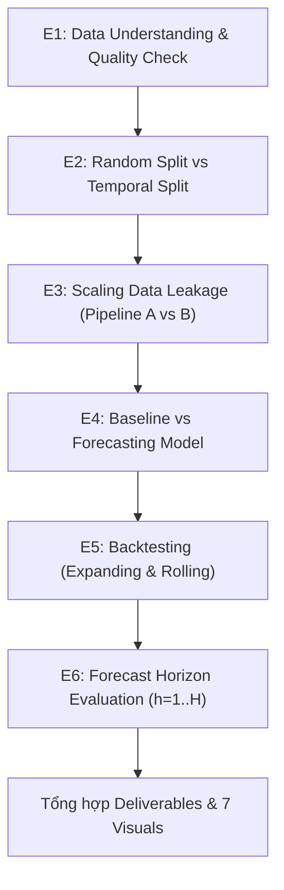

# MASTER EXPERIMENT PLAN — PRESENTATION-24.10.2026 (TOPIC 5)

## 1. Mục tiêu thực nghiệm

Thực hiện chuỗi thí nghiệm từ E1 đến E6 trên một dataset Time Series thực tế để minh họa sinh động và khoa học cho chủ đề:
**Đánh giá mô hình dự báo đúng cách: Data Leakage và Backtesting**.

Toàn bộ kết quả thực nghiệm sẽ tạo ra các bằng chứng số liệu và biểu đồ phục vụ trực tiếp cho bài thuyết trình trong `Presentation_practice.ipynb`. Tuyệt đối không giả định trước kết quả; mọi kết luận phải bắt nguồn từ dữ liệu chạy thực tế.

## 2. Quy trình thực nghiệm (E1 đến E6)

## 3. Danh mục thực nghiệm chi tiết

| Mã | Tên thí nghiệm | Trọng tâm phân tích | Output chính |
|---|---|---|---|
| **E1** | Data Understanding | Khảo sát dataset size, timestamp, target, frequency, date range, missing values, continuity | Bảng thống kê dữ liệu, Visual 1 (Time Series Plot) |
| **E2** | Random Split vs Temporal Split | So sánh tính hợp lệ của việc chia ngẫu nhiên và chia theo dòng thời gian | Visual 2 (Split Diagram), Bảng so sánh sai số lạc quan |
| **E3** | Scaling Data Leakage | So sánh Pipeline A (rò rỉ toàn chuỗi) và Pipeline B (fit trên train, transform test) | Visual 3 (Phân phối scaler), Bảng đối chiếu MAE/RMSE/MAPE |
| **E4** | Baseline vs Forecasting Model | Xây dựng mốc tham chiếu Naive/Seasonal Naive và so sánh với mô hình có học | Visual 4 (Actual vs Forecast), Bảng so sánh baseline |
| **E5** | Backtesting | Kiểm chứng Expanding Window (bắt buộc) và Rolling Window (mở rộng) qua nhiều mốc | Visual 5 (Folds Diagram), Visual 6 (Performance across folds) |
| **E6** | Forecast Horizon Evaluation | Đo lường sự thay đổi của sai số theo từng bước dự báo $h = 1, 2, \dots, H$ | Visual 7 (Error vs Horizon), Bảng chi tiết sai số theo horizon |

## 4. Danh mục 7 Visuals cần bàn giao cho Thuyết trình

1. `01_time_series_overview.png`: Tổng quan chuỗi thời gian, xu hướng và mùa vụ.
2. `02_random_vs_temporal_split.png`: Minh họa việc phá vỡ trật tự thời gian của Random Split.
3. `03_scaling_leakage_comparison.png`: Phân phối thông số scaler và so sánh sai lệch.
4. `04_baseline_vs_model.png`: Đồ thị so sánh dự báo của Baseline vs Model.
5. `05_backtesting_folds.png`: Sơ đồ các fold kiểm chứng theo thời gian.
6. `06_performance_across_folds.png`: Độ biến động và tính ổn định qua các fold.
7. `07_error_by_forecast_horizon.png`: Đường biến thiên sai số theo từng bước $h$.
