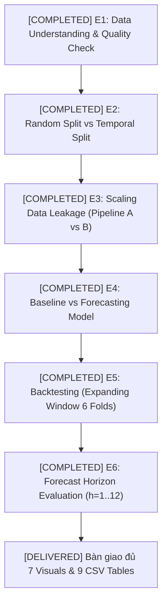

# MASTER EXPERIMENT PLAN — PRESENTATION-24.10.2026 (TOPIC 5)

## 1. Trạng thái thực hiện tổng thể
- **Trạng thái**: `[COMPLETED]` (Toàn bộ 6/6 thí nghiệm đã hoàn thành 100%)
- **Thời điểm nghiệm thu**: 2026-10-25
- **Môi trường thực thi**: Single Execution Engine via `notebooks/Presentation_practice.ipynb`
- **Bộ dữ liệu chuẩn**: `AirPassengers` (`datasets/raw/air_passengers.csv`, 144 tháng)

## 2. Mục tiêu thực nghiệm

Thực hiện chuỗi thí nghiệm từ E1 đến E6 trên dataset Time Series thực tế để minh họa sinh động và khoa học cho chủ đề:
**Đánh giá mô hình dự báo đúng cách: Data Leakage và Backtesting**.

Toàn bộ kết quả thực nghiệm tạo ra các bằng chứng số liệu và biểu đồ phục vụ trực tiếp cho bài thuyết trình trong `Presentation_practice.ipynb`. Tuyệt đối không giả định trước kết quả; mọi kết luận bắt nguồn từ dữ liệu chạy thực tế.

## 3. Quy trình thực nghiệm (E1 đến E6) — Đã hoàn thành 100%

## 4. Bảng nghiệm thu tiến độ chi tiết 6 Thí nghiệm

| Mã | Tên thí nghiệm | Trạng thái | Trọng tâm phân tích | Output bàn giao thực tế |
|:---:|---|:---:|---|---|
| **E1** | Data Understanding | `[COMPLETED]` | Khảo sát 144 tháng, `MS`, monotonicity, 0 missing, min=104, max=622 | `dataset_summary.csv`, `data_quality_report.csv`, Visual 1 (`01_time_series_overview.png`) |
| **E2** | Random Split vs Temporal Split | `[COMPLETED]` | Chứng minh Optimistic Bias: Random Split biến bài toán thành nội suy | `split_comparison_metrics.csv`, Visual 2 (`02_random_vs_temporal_split.png`) |
| **E3** | Scaling Data Leakage | `[COMPLETED]` | So sánh tham số $\mu=291.89$ (A) vs $254.26$ (B), chứng minh rò rỉ phân phối tương lai | `scaler_parameters_comparison.csv`, `scaling_leakage_metrics.csv`, Visual 3 (`03_scaling_leakage_comparison.png`) |
| **E4** | Baseline vs Forecasting Model | `[COMPLETED]` | Đối chứng Naive (76.0), Seasonal Naive (47.83) vs Ridge (14.72, +80.6% cải thiện) | `baseline_vs_model_metrics.csv`, Visual 4 (`04_baseline_vs_model.png`) |
| **E5** | Backtesting | `[COMPLETED]` | Expanding Window 6 folds: Mean MAE=19.01, Mean RMSE=21.19, Mean MAPE=5.34% | `backtesting_folds_summary.csv`, `backtesting_statistical_summary.csv`, Visual 5, Visual 6 |
| **E6** | Forecast Horizon Evaluation | `[COMPLETED]` | Đo lường chi tiết $h=1..12$: sai số biến thiên theo sóng mùa vụ, vượt trội baseline từ 33% đến 75% | `error_by_horizon_table.csv`, Visual 7 (`07_error_by_forecast_horizon.png`) |

## 5. Nghiệm thu bàn giao 7 Visual Artifacts (outputs/figures/)
- [x] `01_time_series_overview.png`: Tổng quan chuỗi thời gian kèm đường Max, Min và Annual Average.
- [x] `02_random_vs_temporal_split.png`: Minh họa Timeline phá vỡ trật tự nhân quả của Random Split.
- [x] `03_scaling_leakage_comparison.png`: Phân phối Histogram đối chứng Pipeline A (Leakage) vs Pipeline B (Correct).
- [x] `04_baseline_vs_model.png`: Đồ thị đường Actual vs Naive vs Seasonal Naive vs Forecaster.
- [x] `05_backtesting_folds.png`: Sơ đồ 6 folds kiểm chứng Expanding Window theo trục thời gian.
- [x] `06_performance_across_folds.png`: Sự biến thiên sai số MAE của mô hình và baseline qua 6 folds.
- [x] `07_error_by_forecast_horizon.png`: Quan hệ giữa sai số và khoảng cách dự báo $h=1..12$.

## 6. Nghiệm thu bàn giao 9 Bảng số liệu (outputs/results/)
- [x] `dataset_summary.csv`
- [x] `data_quality_report.csv`
- [x] `split_comparison_metrics.csv`
- [x] `scaler_parameters_comparison.csv`
- [x] `scaling_leakage_metrics.csv`
- [x] `baseline_vs_model_metrics.csv`
- [x] `backtesting_folds_summary.csv`
- [x] `backtesting_statistical_summary.csv`
- [x] `error_by_horizon_table.csv`

