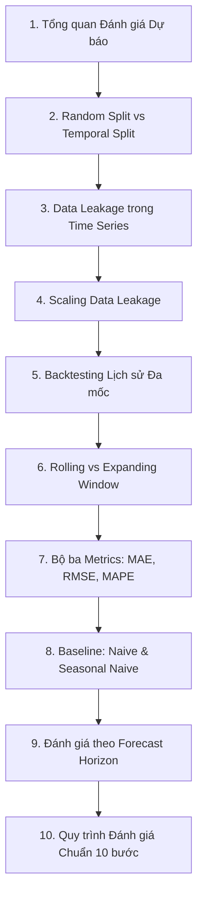
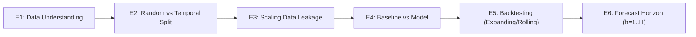
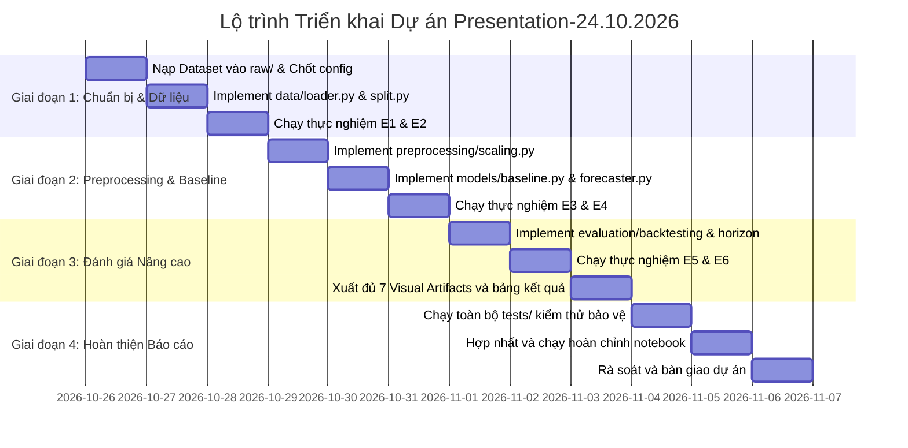

# TÓM TẮT KẾ HOẠCH TOÀN DIỆN DỰ ÁN PRESENTATION-24.10.2026
## CHUYÊN ĐỀ TOPIC 5: ĐÁNH GIÁ MÔ HÌNH DỰ BÁO ĐÚNG CÁCH: DATA LEAKAGE VÀ BACKTESTING

---

## 1. TỔNG QUAN DỰ ÁN VÀ BỐI CẢNH (PROJECT OVERVIEW & CONTEXT)

### 1.1. Bối cảnh & Bản chất Dự án
- **Tên dự án**: `Presentation-24.10.2026`
- **Chủ đề chính**: **Topic 5 — Đánh giá mô hình dự báo đúng cách: Data Leakage và Backtesting** (theo tài liệu chỉ đạo [Time Series.pdf](file:///d:/Documents/Coding/TOTAL_LAB_PRACTICE_FOR_TIME_SERIES/references/Time%20Series.pdf)).
- **Phân loại**: Đây là **bài thuyết trình chuyên đề đột xuất (Presentation Sprint)**, không phải bài thực hành phòng lab dài hạn (như `Practice 1`). Mục tiêu trọng tâm là phương pháp luận đánh giá khoa học, trung thực, ngăn ngừa sai lệch (unbiased) và các cạm bẫy thực tế trong bài toán dự báo chuỗi thời gian (Time Series Forecasting).
- **Trọng tâm cốt lõi**:
  - Không chạy đua tìm kiếm mô hình phức tạp (SOTA/Deep Learning) mà tập trung vào **phương pháp đánh giá đúng (Correct Evaluation Methodology)**.
  - Phân định triệt để giữa dữ liệu quá khứ và tương lai, ngăn chặn rò rỉ thông tin (**Data Leakage** và **Scaling Leakage**).
  - Kiểm định độ bền vững qua thời gian bằng **Backtesting** (Expanding Window & Rolling Window).
  - Thiết lập **Baseline chuẩn** (Naive / Seasonal Naive) làm mốc tham chiếu bắt buộc.
  - Phân tích chi tiết sai số theo từng bước **Forecast Horizon** ($h = 1 \dots H$).
  - Gói gọn toàn bộ báo cáo, biểu đồ và mã nguồn thực thi vào một file Jupyter Notebook duy nhất: [Presentation_practice.ipynb](file:///d:/Documents/Coding/TOTAL_LAB_PRACTICE_FOR_TIME_SERIES/Presentation-24.10.2026/notebooks/Presentation_practice.ipynb).

### 1.2. Hệ thống Tài liệu Căn cứ & Quy tắc Quản trị
Dự án được xây dựng và vận hành nghiêm ngặt dựa trên hệ thống quản trị phân tầng của repository:
1. **Tài liệu nghiệp vụ gốc**: [Time Series.pdf](file:///d:/Documents/Coding/TOTAL_LAB_PRACTICE_FOR_TIME_SERIES/references/Time%20Series.pdf) (Trang 2 đến 23: Toàn bộ đặc tả Topic 5, khung lý thuyết 5W1H và 6 thí nghiệm thực hành E1–E6).
2. **Hiến chương quản trị Human–AI**: [working_rule.md](file:///d:/Documents/Coding/TOTAL_LAB_PRACTICE_FOR_TIME_SERIES/working_rule.md) (11 bước cộng tác, không đoán mò, không nịnh nọt sáo rỗng, lập kế hoạch trước khi sửa đổi, kiểm tra an toàn).
3. **Bộ định tuyến quy tắc**: [.agents/RULES_INDEX.md](file:///d:/Documents/Coding/TOTAL_LAB_PRACTICE_FOR_TIME_SERIES/.agents/RULES_INDEX.md) kết nối đến [.gemini/GEMINI.md](file:///d:/Documents/Coding/TOTAL_LAB_PRACTICE_FOR_TIME_SERIES/.gemini/GEMINI.md).
4. **Quy tắc thực nghiệm & Chuỗi thời gian**:
   - [.agents/rules/GENERAL_RULES.md](file:///d:/Documents/Coding/TOTAL_LAB_PRACTICE_FOR_TIME_SERIES/.agents/rules/GENERAL_RULES.md): Liêm chính học thuật, không tạo kết quả/số liệu giả định.
   - [.agents/rules/TIME_SERIES_RULES.md](file:///d:/Documents/Coding/TOTAL_LAB_PRACTICE_FOR_TIME_SERIES/.agents/rules/TIME_SERIES_RULES.md): Bảo toàn thứ tự thời gian, dữ liệu thô bất biến, không rò rỉ tương lai, Baseline First.
   - [.agents/workflows/WORKFLOW.md](file:///d:/Documents/Coding/TOTAL_LAB_PRACTICE_FOR_TIME_SERIES/.agents/workflows/WORKFLOW.md): Chu trình thực hiện chuẩn (Understand $\rightarrow$ Plan $\rightarrow$ Confirm $\rightarrow$ Execute $\rightarrow$ Verify $\rightarrow$ Report).
   - [Presentation-24.10.2026/README.md](file:///d:/Documents/Coding/TOTAL_LAB_PRACTICE_FOR_TIME_SERIES/Presentation-24.10.2026/README.md): Nguyên tắc `Question -> Experiment -> Result -> Verification -> Interpretation -> Conclusion`.

---

## 2. PHẦN I: KHUNG NGHIÊN CỨU LÝ THUYẾT (10 CHỦ ĐỀ CHUẨN 5W1H)

Toàn bộ 10 chủ đề lý thuyết đã được biên soạn chi tiết trong thư mục [docs/theory/](file:///d:/Documents/Coding/TOTAL_LAB_PRACTICE_FOR_TIME_SERIES/Presentation-24.10.2026/docs/theory/) theo khung chuẩn **5W1H Research Template** (What, Why, When, Where, Who, How, Example/Illustration, Advantages & Limitations):



| STT | Chủ đề nghiên cứu | File tài liệu | Trọng tâm phân tích theo chuẩn 5W1H |
|:---:|---|---|---|
| **01** | Tổng quan về Đánh giá Dự báo Chuỗi thời gian | [01_overview_5w1h.md](file:///d:/Documents/Coding/TOTAL_LAB_PRACTICE_FOR_TIME_SERIES/Presentation-24.10.2026/docs/theory/01_overview_5w1h.md) | Bản chất dự báo là đoán tương lai chưa biết; phân biệt giữa giải thích quá khứ và dự báo; vai trò của Train, Val/Backtest, Test, Baseline và Horizon. |
| **02** | Random Split vs Temporal Split | [02_random_vs_temporal_split.md](file:///d:/Documents/Coding/TOTAL_LAB_PRACTICE_FOR_TIME_SERIES/Presentation-24.10.2026/docs/theory/02_random_vs_temporal_split.md) | Vì sao Random Split biến dự báo thành bài toán nội suy (interpolation); tạo sai lệch lạc quan giả tạo; sự cần thiết tuyệt đối của việc chia cắt theo dòng thời gian (Temporal Split). |
| **03** | Data Leakage trong Time Series | [03_data_leakage.md](file:///d:/Documents/Coding/TOTAL_LAB_PRACTICE_FOR_TIME_SERIES/Presentation-24.10.2026/docs/theory/03_data_leakage.md) | Định nghĩa rò rỉ dữ liệu; hiểm họa sụp đổ mô hình khi triển khai sản xuất; nhận diện 4 vị trí rò rỉ: Data Split, Preprocessing, Feature Engineering và Tuning. |
| **04** | Scaling Data Leakage | [04_scaling_leakage.md](file:///d:/Documents/Coding/TOTAL_LAB_PRACTICE_FOR_TIME_SERIES/Presentation-24.10.2026/docs/theory/04_scaling_leakage.md) | Scaler học $\mu, \sigma, \min, \max$; fit scaler trên toàn chuỗi sẽ "nhìn trộm" tương lai; đối chiếu chi tiết code Sai (Pipeline A) vs code Đúng (Pipeline B). |
| **05** | Backtesting trong Time Series | [05_backtesting_concepts.md](file:///d:/Documents/Coding/TOTAL_LAB_PRACTICE_FOR_TIME_SERIES/Presentation-24.10.2026/docs/theory/05_backtesting_concepts.md) | Vì sao một lần cắt Train/Test đơn lẻ không đủ đại diện; khái niệm Forecast Origin, Train Window, Validation Window, Horizon $H$ và cơ chế chạy từng Fold. |
| **06** | Rolling Window vs Expanding Window | [06_rolling_vs_expanding_window.md](file:///d:/Documents/Coding/TOTAL_LAB_PRACTICE_FOR_TIME_SERIES/Presentation-24.10.2026/docs/theory/06_rolling_vs_expanding_window.md) | Cửa sổ trượt cố định (Rolling) vs Cửa sổ mở rộng tăng dần (Expanding); so sánh giả định về giá trị dữ liệu cũ, khả năng ứng phó thay đổi chế độ (regime shift). |
| **07** | Đánh giá bằng Sai số: MAE, RMSE, MAPE | [07_evaluation_metrics.md](file:///d:/Documents/Coding/TOTAL_LAB_PRACTICE_FOR_TIME_SERIES/Presentation-24.10.2026/docs/theory/07_evaluation_metrics.md) | Công thức toán học; khoảng cách RMSE - MAE đo lường phương sai sai số; cảnh báo rủi ro chia cho 0 của MAPE; ngữ cảnh lựa chọn metric phù hợp mục tiêu. |
| **08** | Baseline Forecast (Mốc tham chiếu) | [08_baseline_forecast.md](file:///d:/Documents/Coding/TOTAL_LAB_PRACTICE_FOR_TIME_SERIES/Presentation-24.10.2026/docs/theory/08_baseline_forecast.md) | Nguyên tắc Baseline First; công thức Naive ($\hat{y}_{t+h}=y_t$) và Seasonal Naive ($\hat{y}_{t+h}=y_{t+h-m}$); công thức đo độ cải thiện Relative Improvement. |
| **09** | Đánh giá theo Forecast Horizon | [09_forecast_horizon.md](file:///d:/Documents/Coding/TOTAL_LAB_PRACTICE_FOR_TIME_SERIES/Presentation-24.10.2026/docs/theory/09_forecast_horizon.md) | Khái niệm bước cự ly $h=1..H$; phân rã sai số theo từng bước để phát hiện điểm thoái hóa của mô hình; nguyên tắc không giả định lỗi bắt buộc tăng tuyến tính. |
| **10** | Quy trình Đánh giá Chuẩn 10 bước | [10_correct_evaluation_workflow.md](file:///d:/Documents/Coding/TOTAL_LAB_PRACTICE_FOR_TIME_SERIES/Presentation-24.10.2026/docs/theory/10_correct_evaluation_workflow.md) | Quy trình tích hợp từ khâu tiếp nhận dữ liệu đến báo cáo cuối cùng; bảng tổng kết các cạm bẫy (Anti-patterns) và giải pháp phòng ngừa khoa học. |

---

## 3. PHẦN II: KHUNG THỰC NGHIỆM THỰC TẾ (E1 ĐẾN E6)

Dự án thiết kế 6 bài thực nghiệm tuần tự theo [master_experiment_plan.md](file:///d:/Documents/Coding/TOTAL_LAB_PRACTICE_FOR_TIME_SERIES/Presentation-24.10.2026/docs/plans/master_experiment_plan.md), chuyển hóa trực tiếp các vấn đề lý thuyết thành bằng chứng số liệu và trực quan hóa:



### Chi tiết 6 Thực nghiệm:

1. **E1 — Data Understanding & Quality Check** ([e1_data_understanding_plan.md](file:///d:/Documents/Coding/TOTAL_LAB_PRACTICE_FOR_TIME_SERIES/Presentation-24.10.2026/docs/plans/e1_data_understanding_plan.md)):
   - **Mục tiêu**: Khảo sát toàn diện dữ liệu trước mô hình hóa: kích thước, cột timestamp, target, frequency (`MS`), date range, missing values, duplicate timestamps, monotonic order.
   - **Outputs**: Bảng thống kê dữ liệu, báo cáo chất lượng dữ liệu, **Visual 1** (`01_time_series_overview.png`).
2. **E2 — Random Split vs Temporal Split** ([e2_split_comparison_plan.md](file:///d:/Documents/Coding/TOTAL_LAB_PRACTICE_FOR_TIME_SERIES/Presentation-24.10.2026/docs/plans/e2_split_comparison_plan.md)):
   - **Mục tiêu**: Thực nghiệm đối chứng chứng minh việc chia ngẫu nhiên (Random Split 80/20) gây sai lệch lạc quan phi thực tế so với chia theo dòng thời gian (Temporal Split).
   - **Outputs**: Bảng so sánh MAE/RMSE/MAPE giữa 2 cách chia, **Visual 2** (`02_random_vs_temporal_split.png`).
3. **E3 — Scaling Data Leakage** ([e3_scaling_leakage_plan.md](file:///d:/Documents/Coding/TOTAL_LAB_PRACTICE_FOR_TIME_SERIES/Presentation-24.10.2026/docs/plans/e3_scaling_leakage_plan.md)):
   - **Mục tiêu**: Đo lường tác hại khi chuẩn hóa dữ liệu sai: So sánh **Pipeline A (Leakage)** (fit scaler trên toàn chuỗi) và **Pipeline B (Correct)** (fit scaler chỉ trên train, transform test).
   - **Outputs**: Bảng so sánh tham số scaler ($\mu, \sigma, \min, \max$), bảng metrics đối chiếu, **Visual 3** (`03_scaling_leakage_comparison.png`).
4. **E4 — Baseline vs Forecasting Model** ([e4_baseline_vs_model_plan.md](file:///d:/Documents/Coding/TOTAL_LAB_PRACTICE_FOR_TIME_SERIES/Presentation-24.10.2026/docs/plans/e4_baseline_vs_model_plan.md)):
   - **Mục tiêu**: Kiểm tra tính hiệu quả thực sự của mô hình học máy (Ridge Regression với Lag features) bằng cách so sánh với Naive và Seasonal Naive.
   - **Outputs**: Bảng chỉ số MAE, RMSE, MAPE, bảng Relative Improvement, **Visual 4** (`04_baseline_vs_model.png`).
5. **E5 — Backtesting (Expanding & Rolling Window)** ([e5_backtesting_plan.md](file:///d:/Documents/Coding/TOTAL_LAB_PRACTICE_FOR_TIME_SERIES/Presentation-24.10.2026/docs/plans/e5_backtesting_plan.md)):
   - **Mục tiêu**: Kiểm tra tính ổn định của mô hình qua nhiều mốc thời gian (tối thiểu 3–5 folds). Bắt buộc thực hiện Expanding Window; mở rộng Rolling Window. Đảm bảo cô lập pipeline độc lập trong từng fold.
   - **Outputs**: Bảng thống kê từng fold, Mean & Std của metrics qua các fold, **Visual 5** (`05_backtesting_folds.png`), **Visual 6** (`06_performance_across_folds.png`).
6. **E6 — Forecast Horizon Evaluation** ([e6_horizon_evaluation_plan.md](file:///d:/Documents/Coding/TOTAL_LAB_PRACTICE_FOR_TIME_SERIES/Presentation-24.10.2026/docs/plans/e6_horizon_evaluation_plan.md)):
   - **Mục tiêu**: Trích xuất ma trận sai số qua các fold để đo lường hiệu năng tại từng bước $h = 1, 2, \dots, H$. Tôn trọng thực nghiệm khách quan, không giả định lỗi luôn tăng tuyến tính.
   - **Outputs**: Bảng sai số chi tiết theo từng bước $h$, **Visual 7** (`07_error_by_forecast_horizon.png`).

---

## 4. DANH MỤC 7 VISUAL ARTIFACTS PHỤC VỤ PRESENTATION

Hệ thống biểu đồ được thiết kế theo tiêu chuẩn xuất bản khoa học, lưu trữ tại `outputs/figures/`:

| STT | Tên file Visual Artifact | Gắn liền với thí nghiệm | Mục đích minh họa trong bài thuyết trình |
|:---:|---|:---:|---|
| **1** | `01_time_series_overview.png` | **E1** | Trực quan hóa toàn bộ chuỗi thời gian, làm nổi bật xu hướng dài hạn (trend) và nhịp điệu mùa vụ (seasonality). |
| **2** | `02_random_vs_temporal_split.png` | **E2** | Sơ đồ dòng thời gian chỉ ra các điểm dữ liệu tương lai bị lọt vào tập train khi chia ngẫu nhiên vs tính nhân quả chuẩn mực của Temporal Split. |
| **3** | `03_scaling_leakage_comparison.png` | **E3** | Biểu đồ đối chiếu sự sai lệch phân phối tham số scaler và mức độ bóp méo sai số giữa Pipeline A và Pipeline B. |
| **4** | `04_baseline_vs_model.png` | **E4** | Đồ thị Actual vs Naive vs Seasonal Naive vs Forecaster, chứng minh mô hình có vượt qua mốc chuẩn hay không. |
| **5** | `05_backtesting_folds.png` | **E5** | Sơ đồ các mốc Forecast Origin và cửa sổ Train / Validation qua các fold backtest (Expanding & Rolling). |
| **6** | `06_performance_across_folds.png` | **E5** | Biểu đồ cột/đường biểu thị độ biến động sai số giữa các giai đoạn lịch sử khác nhau, phát hiện tính thiếu ổn định. |
| **7** | `07_error_by_forecast_horizon.png` | **E6** | Đường biểu diễn sai số theo từng bước chân trời dự báo $h=1..H$, xác định phạm vi tin cậy tối ưu của mô hình. |

---

## 5. CẤU TRÚC KIẾN TRÚC MÃ NGUỒN & HIỆN TRẠNG (CODEBASE ARCHITECTURE)

### 5.1. Cây thư mục dự án
Toàn bộ mã nguồn và tài liệu của dự án được đóng gói khép kín trong [Presentation-24.10.2026/](file:///d:/Documents/Coding/TOTAL_LAB_PRACTICE_FOR_TIME_SERIES/Presentation-24.10.2026):

```text
Presentation-24.10.2026/
├── .gitignore
├── README.md                      # Đặc tả tiền dự án & nguyên tắc thực nghiệm
├── pyproject.toml                 # Cấu hình môi trường Python 3.12 & dependencies
├── config/
│   └── presentation_config.json   # Cấu hình tập trung cho toàn bộ E1..E6
├── datasets/
│   ├── README.md                  # Quy định dữ liệu thô bất biến & derived data
│   ├── raw/                       # Dữ liệu gốc (đang chờ nạp dataset chính thức)
│   └── processed/                 # Dữ liệu qua xử lý/các fold backtest
├── docs/
│   ├── theory/                    # 10 tài liệu nghiên cứu lý thuyết chuẩn 5W1H
│   ├── plans/                     # Master plan và 6 kế hoạch chi tiết E1..E6
│   └── status/
│       └── current_status.md      # Trạng thái hiện tại: Tiền dự án (Pre-project)
├── notebooks/
│   └── Presentation_practice.ipynb # File notebook tâm điểm duy nhất của thuyết trình
├── outputs/
│   ├── figures/                   # Nơi chứa 7 visual artifacts
│   └── results/                   # Bảng số liệu metrics và kết quả so sánh
├── src/
│   └── presentation_24_10_2026/
│       ├── data/
│       │   ├── loader.py          # Tải dữ liệu, validate time index, check data quality
│       │   └── split.py           # Random split vs Temporal split
│       ├── preprocessing/
│       │   └── scaling.py         # Pipeline A (Leakage) vs Pipeline B (Correct)
│       ├── models/
│       │   ├── baseline.py        # Naive Forecast & Seasonal Naive Forecast
│       │   └── forecaster.py      # Mô hình dự báo máy học (Ridge + Lags)
│       ├── evaluation/
│       │   ├── backtesting.py     # Bộ chia fold Expanding & Rolling Window
│       │   ├── horizon.py         # Ma trận sai số theo từng bước h=1..H
│       │   └── metrics.py         # Hàm tính toán MAE, RMSE, MAPE
│       └── visualization/
│           └── plots.py           # Hàm vẽ 7 biểu đồ chuẩn mực khoa học
└── tests/                         # Unit tests bảo vệ tính đúng đắn logic của các module
    ├── test_split.py
    ├── test_scaling.py
    ├── test_baseline.py
    └── test_metrics.py
```

### 5.2. Hiện trạng Codebase
- Cấu hình tập trung [presentation_config.json](file:///d:/Documents/Coding/TOTAL_LAB_PRACTICE_FOR_TIME_SERIES/Presentation-24.10.2026/config/presentation_config.json) đã được định nghĩa đầy đủ các tham số: `test_ratio=0.2`, `random_seed=42`, `season_length=12`, `max_lags=12`, `backtesting` (`initial_train_size=72`, `horizon=12`, `step_size=6`).
- Gói `src/presentation_24_10_2026` đã được thiết kế modular hóa cao, tuân thủ nguyên tắc Single Responsibility:
  - Tất cả các hàm đều có đầy đủ Type hints, Docstrings chi tiết và chú thích nhiệm vụ rõ ràng ở dòng đầu tiên.
  - Hiện tại thân hàm chứa lệnh `pass`, bảo đảm tính kỷ luật tiền dự án (chưa tự ý code trước khi được phê duyệt kế hoạch).
- Bộ khung kiểm thử [tests/](file:///d:/Documents/Coding/TOTAL_LAB_PRACTICE_FOR_TIME_SERIES/Presentation-24.10.2026/tests/) đã thiết lập các ca kiểm thử then chốt: cô lập scaler giữa train và test, bảo toàn thời gian của temporal split, công thức tính toán metrics.
- File [Presentation_practice.ipynb](file:///d:/Documents/Coding/TOTAL_LAB_PRACTICE_FOR_TIME_SERIES/Presentation-24.10.2026/notebooks/Presentation_practice.ipynb) đã được định hình sẵn 8 phần tương ứng với cấu trúc thuyết trình chuẩn:
  1. *Thiết lập môi trường & nạp cấu hình*
  2. *E1 — Data Understanding & Time Index Validation*
  3. *E2 — Random Split vs Temporal Split*
  4. *E3 — Scaling Data Leakage (Pipeline A vs B)*
  5. *E4 — Baseline vs Forecasting Model*
  6. *E5 — Backtesting (Expanding & Rolling Window)*
  7. *E6 — Forecast Horizon Evaluation ($h=1..H$)*
  8. *Quy trình đánh giá chuẩn (10 bước) & Bàn giao kết quả*

---

## 6. CỔNG PHÊ DUYỆT CẦN HUMAN XÁC NHẬN (APPROVAL GATES)

Theo [working_rule.md](file:///d:/Documents/Coding/TOTAL_LAB_PRACTICE_FOR_TIME_SERIES/working_rule.md) và [current_status.md](file:///d:/Documents/Coding/TOTAL_LAB_PRACTICE_FOR_TIME_SERIES/Presentation-24.10.2026/docs/status/current_status.md), để chuyển từ trạng thái `PRE_PROJECT_INITIALIZED` sang `IN_PROGRESS`, cần Human xác nhận 3 nội dung:

1. **Lựa chọn Dataset chính thức**:
   - *Đề xuất ưu tiên*: Sử dụng chuỗi thời gian kinh điển **`AirPassengers`** (144 quan sát hàng tháng từ 1949 đến 1960). Dataset này có đặc tính trend tăng trưởng rõ nét kết hợp mùa vụ mạnh chu kỳ 12 tháng ($m=12$), là mẫu dữ liệu hoàn hảo nhất để:
     - Minh họa trực quan sự sụp đổ khi dùng Random Split.
     - Thấy rõ rò rỉ giá trị max/std tương lai trong Scaling Leakage.
     - So sánh vượt bậc giữa Seasonal Naive và Naive thông thường.
     - Backtesting 5 folds với Expanding Window cực kỳ mượt mà.
   - *Phương án thay thế*: Sử dụng dữ liệu năng lượng/điện lực (Electricity/Energy hourly) hoặc doanh thu bán lẻ (Store Sales daily).
2. **Phê duyệt Kế hoạch Thực nghiệm Tổng thể**:
   - Xác nhận thông qua kế hoạch tổng thể `master_experiment_plan.md` và 6 kế hoạch chi tiết `e1` đến `e6`.
3. **Cấp quyền Triển khai Mã nguồn (Implementation Approval)**:
   - Cho phép viết code giải thuật hoàn chỉnh thay thế các lệnh `pass` trong `src/presentation_24_10_2026/`.
   - Cho phép chạy thực nghiệm, xuất kết quả vào `outputs/` và điền dữ liệu chạy thực tế vào `notebooks/Presentation_practice.ipynb`.

---

## 7. LỘ TRÌNH THỰC THI DỰ KIẾN (EXECUTION ROADMAP)

Sau khi Human phê duyệt các cổng trên, dự án sẽ được triển khai theo 4 giai đoạn mạch lạc:



1. **Giai đoạn 1: Dữ liệu & Phân tách (E1 & E2)**:
   - Nạp dataset `AirPassengers.csv` vào `datasets/raw/`.
   - Triển khai `loader.py` và `split.py`. Thực thi E1 (khảo sát dữ liệu, sinh Visual 1) và E2 (đối chứng Random vs Temporal Split, sinh Visual 2).
2. **Giai đoạn 2: Tiền xử lý, Chống rò rỉ & Baseline (E3 & E4)**:
   - Triển khai `scaling.py` (Pipeline A vs B) và `baseline.py`, `forecaster.py`.
   - Thực thi E3 (đo lường Scaling Leakage, sinh Visual 3) và E4 (so sánh Naive/Seasonal Naive vs Forecaster, sinh Visual 4).
3. **Giai đoạn 3: Backtesting & Chân trời Dự báo (E5 & E6)**:
   - Triển khai `backtesting.py`, `horizon.py` và `metrics.py`.
   - Thực thi E5 (Expanding & Rolling Backtesting qua 5 folds, sinh Visual 5 & 6) và E6 (ma trận sai số $h=1..12$, sinh Visual 7).
   - Xuất đầy đủ số liệu vào `outputs/results/`.
4. **Giai đoạn 4: Kiểm thử, Tích hợp Notebook & Đóng gói Thuyết trình**:
   - Chạy `pytest tests/` bảo đảm 100% test cases vượt qua.
   - Chạy tuần tự và hoàn chỉnh toàn bộ các ô lệnh trong [Presentation_practice.ipynb](file:///d:/Documents/Coding/TOTAL_LAB_PRACTICE_FOR_TIME_SERIES/Presentation-24.10.2026/notebooks/Presentation_practice.ipynb).
   - Bàn giao báo cáo tổng kết, hoàn tất bài thuyết trình chuyên đề Topic 5.
