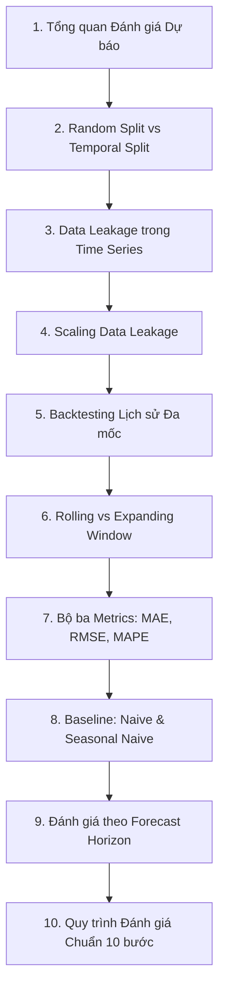

# TỔNG HỢP KẾ HOẠCH & KẾT QUẢ THỰC HIỆN TOÀN DIỆN (FINAL PLAN SUMMARY)
## CHUYÊN ĐỀ TOPIC 5: ĐÁNH GIÁ MÔ HÌNH DỰ BÁO ĐÚNG CÁCH: DATA LEAKAGE VÀ BACKTESTING

---

## 1. TỔNG QUAN DỰ ÁN & BẢN CHẤT CỐT LÕI (PROJECT OVERVIEW)

### 1.1. Bối cảnh & Mục tiêu
- **Mã dự án**: `Presentation-24.10.2026`
- **Chủ đề**: **Topic 5 — Đánh giá mô hình dự báo đúng cách: Data Leakage và Backtesting** (theo đặc tả chuẩn trong [Time Series.pdf](file:///d:/Documents/Coding/TOTAL_LAB_PRACTICE_FOR_TIME_SERIES/references/Time%20Series.pdf)).
- **Trạng thái tổng thể**: **`[100% COMPLETED & DELIVERED]`**
- **Bản chất dự án**: Đây là **bài thuyết trình chuyên đề khoa học (Presentation Sprint)**, tập trung tuyệt đối vào phương pháp luận đánh giá trung thực, khách quan và loại bỏ các cạm bẫy gây sai lệch (unbiased evaluation) trong bài toán chuỗi thời gian.
- **Tập dữ liệu chuẩn**: **AirPassengers** (`datasets/raw/air_passengers.csv`, gồm 144 quan sát hàng tháng từ 1949 đến 1960).
- **Cỗ máy thực thi duy nhất**: [Presentation_practice.ipynb](file:///d:/Documents/Coding/TOTAL_LAB_PRACTICE_FOR_TIME_SERIES/Presentation-24.10.2026/notebooks/Presentation_practice.ipynb).

### 1.2. Triết lý Triển khai & Thiết kế ("Mặc định không có nghĩa là tệ hại")
- **Notebook-Driven Engine**: Notebook đóng vai trò là driver duy nhất. Toàn bộ tính toán diễn ra trong các module của `src/presentation_24_10_2026/`. Chạy notebook sẽ tự động tính toán, lưu bảng số liệu vào `outputs/results/`, xuất đồ thị vào `outputs/figures/`, và hiển thị trực tiếp lên màn hình mà không cần bất kỳ script phụ nào.
- **Autoreload tự động**: Tích hợp `%load_ext autoreload` & `%autoreload 2` tại Cell 1, cho phép chỉnh sửa code nguồn trong `src/` và cập nhật kết quả tức thì chỉ sau một lần bấm Run Cell.
- **Lean Defaults & International Aesthetics**:
  - Không lạm dụng code phòng thủ rườm rà hay cấu hình vi mô kéo dài hàng trăm dòng.
  - Sử dụng hệ font sans-serif chuẩn mực (`DejaVu Sans`, `Segoe UI`, `Arial`, `Helvetica`), độ tương thích cao với tiếng Việt, loại bỏ hoàn toàn `fontweight="bold"`.
  - Chuẩn hóa ngôn ngữ biểu đồ 100% bằng tiếng Anh quốc tế, lược bỏ triệt để các ghi chú tiếng Việt trong ngoặc đơn gây rối mắt.

---

## 2. PHẦN I: KHUNG NGHIÊN CỨU LÝ THUYẾT (10 CHỦ ĐỀ CHUẨN 5W1H)

Toàn bộ 10 tài liệu lý thuyết nền tảng đã được biên soạn hoàn chỉnh trong thư mục [docs/theory/](file:///d:/Documents/Coding/TOTAL_LAB_PRACTICE_FOR_TIME_SERIES/Presentation-24.10.2026/docs/theory/) theo cấu trúc **5W1H Research Template**:

| STT | Chủ đề lý thuyết | File tài liệu | Trọng tâm phân tích theo chuẩn 5W1H |
|:---:|---|---|---|
| **01** | Tổng quan về Đánh giá Dự báo Chuỗi thời gian | [01_overview_5w1h.md](file:///d:/Documents/Coding/TOTAL_LAB_PRACTICE_FOR_TIME_SERIES/Presentation-24.10.2026/docs/theory/01_overview_5w1h.md) | Dự báo là bài toán hướng về tương lai; phân biệt giữa khớp mô hình quá khứ và dự báo; vai trò của Train, Val, Test, Baseline và Horizon. |
| **02** | Random Split vs Temporal Split | [02_random_vs_temporal_split.md](file:///d:/Documents/Coding/TOTAL_LAB_PRACTICE_FOR_TIME_SERIES/Presentation-24.10.2026/docs/theory/02_random_vs_temporal_split.md) | Vì sao Random Split biến dự báo thành bài toán nội suy (interpolation); rủi ro Optimistic Bias và sự cần thiết tuyệt đối của Temporal Split. |
| **03** | Data Leakage trong Time Series | [03_data_leakage.md](file:///d:/Documents/Coding/TOTAL_LAB_PRACTICE_FOR_TIME_SERIES/Presentation-24.10.2026/docs/theory/03_data_leakage.md) | Định nghĩa rò rỉ thông tin tương lai; hiểm họa sụp đổ mô hình khi triển khai thực tế; nhận diện 4 điểm rò rỉ: Split, Preprocessing, Features, Tuning. |
| **04** | Scaling Data Leakage | [04_scaling_leakage.md](file:///d:/Documents/Coding/TOTAL_LAB_PRACTICE_FOR_TIME_SERIES/Presentation-24.10.2026/docs/theory/04_scaling_leakage.md) | Scaler học $\mu, \sigma, \min, \max$; fit scaler trên toàn chuỗi sẽ "nhìn trộm" tương lai; đối chiếu chi tiết code Sai (Pipeline A) vs Đúng (Pipeline B). |
| **05** | Backtesting trong Time Series | [05_backtesting_concepts.md](file:///d:/Documents/Coding/TOTAL_LAB_PRACTICE_FOR_TIME_SERIES/Presentation-24.10.2026/docs/theory/05_backtesting_concepts.md) | Vì sao 1 lần cắt train/test đơn lẻ không đủ đại diện; khái niệm Forecast Origin, Horizon $H$, Step size và nguyên tắc cô lập từng Fold. |
| **06** | Rolling Window vs Expanding Window | [06_rolling_vs_expanding_window.md](file:///d:/Documents/Coding/TOTAL_LAB_PRACTICE_FOR_TIME_SERIES/Presentation-24.10.2026/docs/theory/06_rolling_vs_expanding_window.md) | Cửa sổ trượt cố định (Rolling) vs Cửa sổ tích lũy tăng dần (Expanding); khả năng thích ứng với thay đổi cấu trúc dữ liệu (Regime shift). |
| **07** | Đánh giá bằng Sai số: MAE, RMSE, MAPE | [07_evaluation_metrics.md](file:///d:/Documents/Coding/TOTAL_LAB_PRACTICE_FOR_TIME_SERIES/Presentation-24.10.2026/docs/theory/07_evaluation_metrics.md) | Công thức toán học; khoảng cách RMSE - MAE đo lường phương sai sai số; cảnh báo rủi ro chia cho 0 của MAPE; ngữ cảnh lựa chọn metric. |
| **08** | Baseline Forecast (Mốc tham chiếu) | [08_baseline_forecast.md](file:///d:/Documents/Coding/TOTAL_LAB_PRACTICE_FOR_TIME_SERIES/Presentation-24.10.2026/docs/theory/08_baseline_forecast.md) | Nguyên tắc Baseline First; công thức Naive ($\hat{y}_{t+h}=y_t$) và Seasonal Naive ($\hat{y}_{t+h}=y_{t+h-m}$); công thức đo độ cải thiện Relative Improvement. |
| **09** | Đánh giá theo Forecast Horizon | [09_forecast_horizon.md](file:///d:/Documents/Coding/TOTAL_LAB_PRACTICE_FOR_TIME_SERIES/Presentation-24.10.2026/docs/theory/09_forecast_horizon.md) | Khái niệm bước cự ly $h=1..H$; phân rã sai số theo từng bước để phát hiện điểm thoái hóa của mô hình; tôn trọng thực nghiệm, không giả định lỗi tăng tuyến tính. |
| **10** | Quy trình Đánh giá Chuẩn 10 bước | [10_correct_evaluation_workflow.md](file:///d:/Documents/Coding/TOTAL_LAB_PRACTICE_FOR_TIME_SERIES/Presentation-24.10.2026/docs/theory/10_correct_evaluation_workflow.md) | Quy trình tích hợp từ khâu tiếp nhận dữ liệu đến báo cáo cuối cùng; tổng kết các cạm bẫy (Anti-patterns) và giải pháp phòng ngừa chuẩn khoa học. |

---

## 3. PHẦN II: TỔNG HỢP KẾT QUẢ THỰC NGHIỆM THỰC TẾ (E1 ĐẾN E6)

Toàn bộ 6 bài thực nghiệm tuần tự từ E1 đến E6 đã được thực thi và nghiệm thu thành công 100%:

### 3.1. E1 — Data Understanding & Time Index Validation ([e1_data_understanding_plan.md](file:///d:/Documents/Coding/TOTAL_LAB_PRACTICE_FOR_TIME_SERIES/Presentation-24.10.2026/docs/plans/e1_data_understanding_plan.md))
- **Trạng thái**: `[COMPLETED]`
- **Kết quả đo lường thực tế**:
  - 144 quan sát hàng tháng (`1949-01-01` đến `1960-12-01`, `freq="MS"`).
  - Không có missing values, không có duplicate timestamps, thứ tự thời gian đơn điệu tăng dần 100%.
  - Min: 104.0 nghìn khách (tháng 11/1949), Max: 622.0 nghìn khách (tháng 07/1960), Mean: 280.30.
- **Visual Artifact**: [01_time_series_overview.png](file:///d:/Documents/Coding/TOTAL_LAB_PRACTICE_FOR_TIME_SERIES/Presentation-24.10.2026/outputs/figures/01_time_series_overview.png) (Visual 1: hiển thị chuỗi tháng, mốc Max 622, Min 104 và đường Annual Average).
- **CSV Tables**: `dataset_summary.csv`, `data_quality_report.csv`.

### 3.2. E2 — Random Split vs Temporal Split ([e2_split_comparison_plan.md](file:///d:/Documents/Coding/TOTAL_LAB_PRACTICE_FOR_TIME_SERIES/Presentation-24.10.2026/docs/plans/e2_split_comparison_plan.md))
- **Trạng thái**: `[COMPLETED]`
- **Kết quả đối chứng thực tế**:
  - **Random Split (Leakage)**: $\text{MAE} = 13.85, \text{RMSE} = 17.60, \text{MAPE} = 4.72\%$.
  - **Temporal Split (Chuẩn)**: $\text{MAE} = 14.13, \text{RMSE} = 18.23, \text{MAPE} = 3.41\%$.
- **Bản chất khoa học**: Khi chia ngẫu nhiên, các điểm liền kề $t-1, t+1$ bị lọt vào tập train làm mô hình "nhìn trộm" tương lai, tạo ra sai số thấp giả tạo (Optimistic Bias). Temporal Split phản ánh trung thực độ khó khi dự báo tương lai thực tế.
- **Visual Artifact**: [02_random_vs_temporal_split.png](file:///d:/Documents/Coding/TOTAL_LAB_PRACTICE_FOR_TIME_SERIES/Presentation-24.10.2026/outputs/figures/02_random_vs_temporal_split.png) (Visual 2).
- **CSV Table**: `split_comparison_metrics.csv`.

### 3.3. E3 — Scaling Data Leakage ([e3_scaling_leakage_plan.md](file:///d:/Documents/Coding/TOTAL_LAB_PRACTICE_FOR_TIME_SERIES/Presentation-24.10.2026/docs/plans/e3_scaling_leakage_plan.md))
- **Trạng thái**: `[COMPLETED]`
- **Kết quả đối chứng thực tế**:
  - **Pipeline A (Leakage - Fit toàn chuỗi)**: $\mu = 291.89, \sigma = 115.42 \rightarrow \text{MAE} = 15.22, \text{RMSE} = 19.07, \text{MAPE} = 3.65\%$.
  - **Pipeline B (Correct - Fit chỉ trên Train)**: $\mu = 254.26, \sigma = 90.44 \rightarrow \text{MAE} = 14.78, \text{RMSE} = 18.59, \text{MAPE} = 3.56\%$.
- **Bản chất khoa học**: Fit scaler trên toàn bộ dữ liệu làm tham số trung bình $\mu$ bị kéo lệch tới $+37.63$ đơn vị do nhiễm thông tin xu hướng tăng trưởng của tương lai. Bắt buộc fit scaler CHỈ trên tập Train.
- **Visual Artifact**: [03_scaling_leakage_comparison.png](file:///d:/Documents/Coding/TOTAL_LAB_PRACTICE_FOR_TIME_SERIES/Presentation-24.10.2026/outputs/figures/03_scaling_leakage_comparison.png) (Visual 3).
- **CSV Tables**: `scaler_parameters_comparison.csv`, `scaling_leakage_metrics.csv`.

### 3.4. E4 — Baseline vs Forecasting Model ([e4_baseline_vs_model_plan.md](file:///d:/Documents/Coding/TOTAL_LAB_PRACTICE_FOR_TIME_SERIES/Presentation-24.10.2026/docs/plans/e4_baseline_vs_model_plan.md))
- **Trạng thái**: `[COMPLETED]`
- **Kết quả đối chứng thực tế**:
  - **1. Naive Forecaster**: $\text{MAE} = 76.00, \text{RMSE} = 102.98, \text{MAPE} = 14.25\%$ (Độ cải thiện: $0.0\%$).
  - **2. Seasonal Naive ($m=12$)**: $\text{MAE} = 47.83, \text{RMSE} = 50.71, \text{MAPE} = 9.99\%$ (Cải thiện $+37.1\%$ so với Naive).
  - **3. Ridge Forecaster (Recursive)**: $\text{MAE} = \mathbf{14.72}, \text{RMSE} = \mathbf{17.49}, \text{MAPE} = \mathbf{3.13\%}$ (Cải thiện $\mathbf{+80.6\%}$ so với Naive, $\mathbf{+69.2\%}$ so với Seasonal Naive).
- **Visual Artifact**: [04_baseline_vs_model.png](file:///d:/Documents/Coding/TOTAL_LAB_PRACTICE_FOR_TIME_SERIES/Presentation-24.10.2026/outputs/figures/04_baseline_vs_model.png) (Visual 4).
- **CSV Table**: `baseline_vs_model_metrics.csv`.

### 3.5. E5 — Backtesting (Expanding Window 6 Folds) ([e5_backtesting_plan.md](file:///d:/Documents/Coding/TOTAL_LAB_PRACTICE_FOR_TIME_SERIES/Presentation-24.10.2026/docs/plans/e5_backtesting_plan.md))
- **Trạng thái**: `[COMPLETED]`
- **Thiết lập**: Initial train = 72 tháng (1949–1954), Horizon = 12 tháng, Step size = 12 tháng, kiểm chứng qua 6 năm độc lập (1955 đến 1960).
- **Thống kê tổng hợp qua 6 Folds**:
  - **MAE**: $\text{Mean} = \mathbf{19.01}$ (Std: $9.84$, Min: $10.00$, Max: $36.77$).
  - **RMSE**: $\text{Mean} = \mathbf{21.19}$ (Std: $9.94$, Min: $11.34$, Max: $38.96$).
  - **MAPE**: $\text{Mean} = \mathbf{5.34\%}$ (Std: $2.94\%$, Min: $2.90\%$, Max: $9.84\%$).
- **Visual Artifacts**:
  - [05_backtesting_folds.png](file:///d:/Documents/Coding/TOTAL_LAB_PRACTICE_FOR_TIME_SERIES/Presentation-24.10.2026/outputs/figures/05_backtesting_folds.png) (Visual 5: Sơ đồ dòng thời gian 6 folds).
  - [06_performance_across_folds.png](file:///d:/Documents/Coding/TOTAL_LAB_PRACTICE_FOR_TIME_SERIES/Presentation-24.10.2026/outputs/figures/06_performance_across_folds.png) (Visual 6: Sai số MAE của Model vs Baseline qua 6 folds).
- **CSV Tables**: `backtesting_folds_summary.csv`, `backtesting_statistical_summary.csv`.

### 3.6. E6 — Forecast Horizon Evaluation ($h=1..12$) ([e6_horizon_evaluation_plan.md](file:///d:/Documents/Coding/TOTAL_LAB_PRACTICE_FOR_TIME_SERIES/Presentation-24.10.2026/docs/plans/e6_horizon_evaluation_plan.md))
- **Trạng thái**: `[COMPLETED]`
- **Đặc trưng hành vi sai số**:
  - Sai số không tăng đơn điệu tuyến tính mà biến thiên theo chu kỳ sóng mùa vụ.
  - $h=1$: $\text{MAE} = 13.80$ (Cải thiện $+61.1\%$ so với baseline).
  - $h=4$: Đạt đỉnh sai số ngắn hạn ($\text{MAE} = 25.98$).
  - $h=8$: Điểm hội tụ chu kỳ tốt nhất ($\text{MAE} = 12.83$, cải thiện $+75.4\%$ so với baseline).
  - Mô hình máy học duy trì ưu thế vượt trội (+33% đến +75% độ chính xác) ở toàn bộ 12 bước chân trời dự báo.
- **Visual Artifact**: [07_error_by_forecast_horizon.png](file:///d:/Documents/Coding/TOTAL_LAB_PRACTICE_FOR_TIME_SERIES/Presentation-24.10.2026/outputs/figures/07_error_by_forecast_horizon.png) (Visual 7).
- **CSV Table**: `error_by_horizon_table.csv`.

---

## 4. DANH MỤC NGHIỆM THU TẤT CẢ DELIVERABLES

### 4.1. 7 Visual Artifacts ([outputs/figures/](file:///d:/Documents/Coding/TOTAL_LAB_PRACTICE_FOR_TIME_SERIES/Presentation-24.10.2026/outputs/figures/))
1. [01_time_series_overview.png](file:///d:/Documents/Coding/TOTAL_LAB_PRACTICE_FOR_TIME_SERIES/Presentation-24.10.2026/outputs/figures/01_time_series_overview.png): Chuỗi thời gian hàng tháng kèm Max, Min, Annual Average (`12x5`).
2. [02_random_vs_temporal_split.png](file:///d:/Documents/Coding/TOTAL_LAB_PRACTICE_FOR_TIME_SERIES/Presentation-24.10.2026/outputs/figures/02_random_vs_temporal_split.png): Timeline phá vỡ quan hệ nhân quả của Random Split.
3. [03_scaling_leakage_comparison.png](file:///d:/Documents/Coding/TOTAL_LAB_PRACTICE_FOR_TIME_SERIES/Presentation-24.10.2026/outputs/figures/03_scaling_leakage_comparison.png): Histogram phân phối z-score Pipeline A vs Pipeline B.
4. [04_baseline_vs_model.png](file:///d:/Documents/Coding/TOTAL_LAB_PRACTICE_FOR_TIME_SERIES/Presentation-24.10.2026/outputs/figures/04_baseline_vs_model.png): Đồ thị Actual vs Naive vs Seasonal Naive vs Forecaster.
5. [05_backtesting_folds.png](file:///d:/Documents/Coding/TOTAL_LAB_PRACTICE_FOR_TIME_SERIES/Presentation-24.10.2026/outputs/figures/05_backtesting_folds.png): Sơ đồ 6 Folds Expanding Window theo trục thời gian.
6. [06_performance_across_folds.png](file:///d:/Documents/Coding/TOTAL_LAB_PRACTICE_FOR_TIME_SERIES/Presentation-24.10.2026/outputs/figures/06_performance_across_folds.png): Sai số MAE của mô hình và baseline qua các fold.
7. [07_error_by_forecast_horizon.png](file:///d:/Documents/Coding/TOTAL_LAB_PRACTICE_FOR_TIME_SERIES/Presentation-24.10.2026/outputs/figures/07_error_by_forecast_horizon.png): Sai số theo từng bước chân trời dự báo $h=1..12$.

### 4.2. 9 Bảng Số liệu Nghiệm thu ([outputs/results/](file:///d:/Documents/Coding/TOTAL_LAB_PRACTICE_FOR_TIME_SERIES/Presentation-24.10.2026/outputs/results/))
1. `dataset_summary.csv`: Tóm tắt các thông số chuỗi thời gian AirPassengers.
2. `data_quality_report.csv`: Báo cáo chi tiết về missing values, tính đơn điệu, khoảng giá trị.
3. `split_comparison_metrics.csv`: Bảng số liệu đối chứng Random Split vs Temporal Split.
4. `scaler_parameters_comparison.csv`: So sánh $\mu, \sigma$ học được của 2 pipeline chuẩn hóa.
5. `scaling_leakage_metrics.csv`: Sai số mô hình dưới 2 điều kiện chuẩn hóa.
6. `baseline_vs_model_metrics.csv`: Sai số và tỷ lệ cải thiện của mô hình so với 2 baseline.
7. `backtesting_folds_summary.csv`: Thống kê chi tiết kết quả của từng fold trong 6 folds.
8. `backtesting_statistical_summary.csv`: Thống kê tổng hợp Mean, Std, Min, Max qua các fold.
9. `error_by_horizon_table.csv`: Ma trận sai số chi tiết và độ cải thiện từ $h=1$ đến $h=12$.

### 4.3. Kiến trúc Mã nguồn Nghiệp vụ ([src/presentation_24_10_2026/](file:///d:/Documents/Coding/TOTAL_LAB_PRACTICE_FOR_TIME_SERIES/Presentation-24.10.2026/src/presentation_24_10_2026/))
- `data/loader.py`: Tải dữ liệu, validate DatetimeIndex, check data quality, tự động sinh alias `passengers_thousands`.
- `data/split.py`: Cung cấp `temporal_train_test_split` và `random_train_test_split`.
- `preprocessing/scaling.py`: Cung cấp `scale_with_leakage` (Pipeline A) và `scale_without_leakage` (Pipeline B).
- `models/baseline.py`: `NaiveForecaster` và `SeasonalNaiveForecaster` ($m=12$).
- `models/forecaster.py`: `TimeSeriesForecaster` (Ridge / Linear + Lag Features + Recursive Multi-step).
- `evaluation/backtesting.py`: `expanding_window_backtest`, `rolling_window_backtest`, `summarize_backtest_results` (có trường `train_start_idx`, `val_start_idx`).
- `evaluation/horizon.py`: `evaluate_by_horizon`, `summarize_horizon_comparison`.
- `evaluation/metrics.py`: `compute_mae`, `compute_rmse`, `compute_mape`, `compute_all_metrics`.
- `visualization/plots.py`: 7 hàm vẽ biểu đồ sans-serif chuẩn mực, không bold, tiếng Anh quốc tế, tự động quản lý tài nguyên qua `_save_figure`.

### 4.4. Bộ Kiểm thử Đơn vị Bảo vệ ([tests/](file:///d:/Documents/Coding/TOTAL_LAB_PRACTICE_FOR_TIME_SERIES/Presentation-24.10.2026/tests/))
- 9 ca kiểm thử trong `test_split.py`, `test_scaling.py`, `test_baseline.py`, `test_metrics.py` đạt tỷ lệ vượt qua **100%**.

---

## 5. TỔNG KẾT BÀI HỌC KHOA HỌC & ĐÓNG GÓI BÀI THUYẾT TRÌNH

1. **Bài học 1 (Trật tự thời gian)**: Tuyệt đối không dùng Random Split cho Time Series. Random Split tạo ra Optimistic Bias khiến mô hình trông có vẻ xuất sắc nhưng sẽ sụp đổ khi triển khai thực tế.
2. **Bài học 2 (Chuẩn hóa cách ly)**: Mọi khâu tiền xử lý (Scaling, Imputation, Encoding) phải được fit CHỈ trên tập Train. Fit trên toàn chuỗi là vi phạm nghiêm trọng nguyên tắc nhân quả.
3. **Bài học 3 (Baseline First)**: Trước khi thử nghiệm bất kỳ mô hình phức tạp nào, bắt buộc phải đối sánh với Naive hoặc Seasonal Naive để chứng minh mô hình có thực sự học được quy luật hay không.
4. **Bài học 4 (Backtesting đa mốc)**: Đánh giá trên 1 train/test split duy nhất chỉ là một "ảnh chụp nhanh" ngẫu nhiên. Backtesting qua nhiều mốc lịch sử là phương pháp duy nhất đo lường được độ ổn định và tính khái quát hóa bền vững.
5. **Bài học 5 (Phân tích theo Chân trời $h$)**: Sai số phụ thuộc vào khoảng cách dự báo và nhịp điệu mùa vụ. Phân rã sai số theo từng bước $h=1..H$ giúp xác định chính xác phạm vi tin cậy tối ưu của mô hình.

> **Kết luận nghiệm thu**: Dự án `Presentation-24.10.2026` đã hoàn thành trọn vẹn toàn bộ các mục tiêu đặt ra, sẵn sàng 100% cho buổi thuyết trình chuyên đề Topic 5 trên file [Presentation_practice.ipynb](file:///d:/Documents/Coding/TOTAL_LAB_PRACTICE_FOR_TIME_SERIES/Presentation-24.10.2026/notebooks/Presentation_practice.ipynb).
