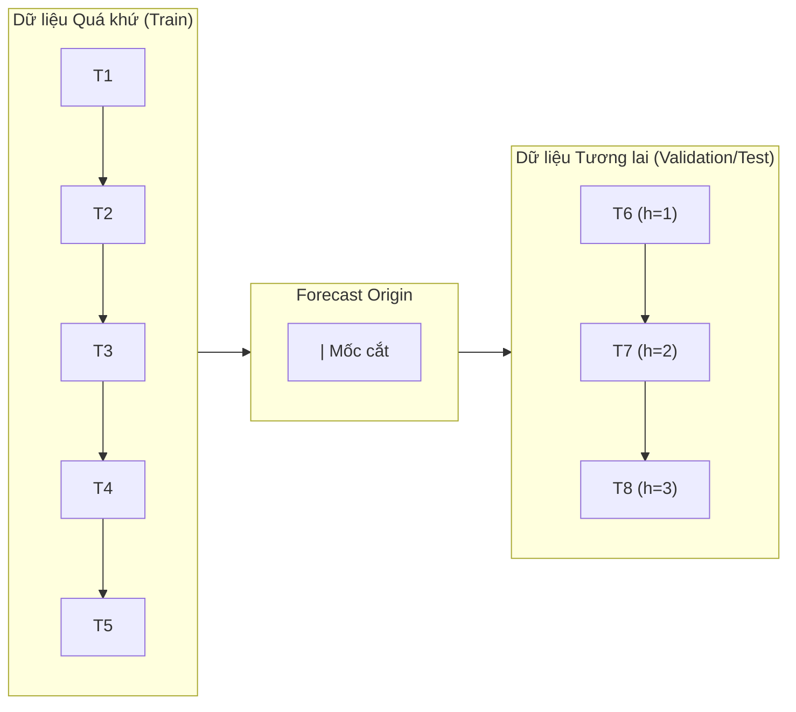

# 1. TỔNG QUAN VỀ ĐÁNH GIÁ MÔ HÌNH DỰ BÁO CHUỖI THỜI GIAN

> **Khung nghiên cứu**: Tuân thủ chuẩn 5W1H Research Template (What, Why, When, Where, Who, How, Example/Illustration, Advantages & Limitations).

---

### 1. WHAT — Khái niệm là gì?
- **Forecast Evaluation (Đánh giá dự báo)**: Là quá trình đo lường định lượng và định tính độ chính xác cùng tính ổn định của mô hình dự báo trên những quan sát trong tương lai (không được sử dụng trong quá trình huấn luyện).
- **Data Leakage (Rò rỉ dữ liệu)**: Là hiện tượng thông tin từ tương lai hoặc từ tập đánh giá (validation/test) vô tình bị đưa vào quá trình huấn luyện, tạo đặc trưng hoặc tiền xử lý của mô hình quá khứ.
- **Backtesting (Kiểm chứng lịch sử)**: Là kỹ thuật mô phỏng lặp đi lặp lại quá trình dự báo tại nhiều thời điểm khác nhau trong quá khứ nhằm kiểm tra độ bền vững của mô hình.

### 2. WHY — Tại sao quan trọng?
- Forecasting hướng tới việc dự đoán những giá trị **chưa từng xảy ra**, khác với bài toán giải thích dữ liệu đã có.
- Chuỗi thời gian có thứ tự phụ thuộc nhân quả một chiều; một quan sát tương lai không thể xem là độc lập để xáo trộn ngẫu nhiên.
- Đánh giá sai cách sẽ dẫn đến sai số thấp giả tạo, gây ảo tưởng về năng lực mô hình và dẫn đến thất bại nghiêm trọng khi triển khai thực tế.

### 3. WHEN — Khi nào cần sử dụng / chú ý?
- Trong suốt chu trình phát triển mô hình dự báo:
  - Khi thiết kế phương án chia tập dữ liệu.
  - Trong quá trình lựa chọn mô hình (Model Selection).
  - Khi tinh chỉnh siêu tham số (Hyperparameter Tuning).
  - Trước khi quyết định đưa mô hình vào môi trường sản xuất (Deployment).

### 4. WHERE — Xuất hiện ở đâu trong workflow?
- Rủi ro xuất hiện xuyên suốt các bước:
  - Chia tập dữ liệu (Data Split).
  - Tiền xử lý (Preprocessing & Imputation).
  - Kỹ nghệ đặc trưng (Feature Engineering).
  - Kiểm chứng chéo và đánh giá kết quả (Validation & Evaluation).

### 5. WHO — Thành phần nào liên quan?
| Thành phần | Vai trò |
|---|---|
| **Train set** | Dữ liệu quá khứ dùng để học tham số mô hình và các bước tiền xử lý. |
| **Validation / Backtest** | Dữ liệu tương lai giả lập dùng để so sánh các mô hình và tuning tham số. |
| **Test set** | Tập dữ liệu độc lập cuối cùng dùng để đánh giá năng lực thực tế sau khi đã chốt mô hình. |
| **Baseline** | Mốc chuẩn tham chiếu cơ sở để kiểm tra giá trị thực sự của mô hình phức tạp. |
| **Forecast Horizon** | Số bước dự báo về phía trước mà mô hình cần đáp ứng. |

### 6. HOW — Hoạt động / áp dụng như thế nào?
Quy trình đánh giá chuẩn gồm chuỗi các bước tuần tự:
```text
Giữ vững thứ tự thời gian
       ↓
Temporal split hoặc Backtesting
       ↓
Fit preprocessing chỉ trên dữ liệu quá khứ
       ↓
So sánh bắt buộc với Baseline
       ↓
Tính metrics và phân tích theo Forecast Horizon
```

### 7. EXAMPLE / ILLUSTRATION — Minh họa


### 8. ADVANTAGES & LIMITATIONS — Ưu điểm & Hạn chế
- **Ưu điểm**: Phản ánh chân thực điều kiện hoạt động của mô hình khi triển khai, loại bỏ rủi ro rò rỉ dữ liệu, đảm bảo kết quả đánh giá khách quan và đáng tin cậy.
- **Hạn chế**: Đòi hỏi quy trình tiền xử lý và validation phức tạp hơn so với bài toán tabular ML thông thường; chi phí tính toán cao hơn khi backtesting nhiều fold.
