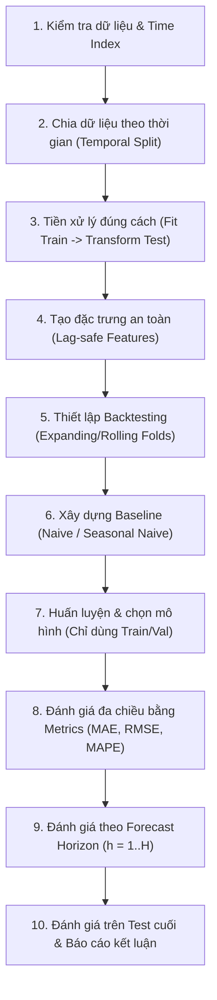

# 10. QUY TRÌNH ĐÁNH GIÁ DỰ BÁO CHUẨN (CORRECT EVALUATION WORKFLOW)

> **Khung nghiên cứu**: Tuân thủ chuẩn 5W1H Research Template (What, Why, When, Where, Who, How, Example/Illustration, Advantages & Limitations).

---

### 1. WHAT — Khái niệm là gì?
- **Correct Evaluation Workflow**: Là quy trình đánh giá toàn diện mô hình chuỗi thời gian được chuẩn hóa khoa học nhằm mô phỏng chính xác điều kiện triển khai thực tế: Dùng dữ liệu quá khứ để dự báo tương lai, triệt tiêu mọi rủi ro Data Leakage, so sánh công bằng với Baseline và kiểm định độ bền vững qua thời gian.

### 2. WHY — Tại sao cần có một quy trình chuẩn hóa?
- Ngăn ngừa các sai lầm phổ biến có thể làm sai lệch hoàn toàn kết quả nghiên cứu:
  - Chia ngẫu nhiên (Random Split).
  - Chuẩn hóa trên toàn bộ tập dữ liệu (Scaling Leakage).
  - Tạo đặc trưng hướng tương lai.
  - Tối ưu hóa siêu tham số trên tập test.
  - Tự hài lòng với mô hình mà không biết nó có tệ hơn Naive Forecast hay không.

### 3. WHEN — Khi nào áp dụng?
- Áp dụng làm tiêu chuẩn bắt buộc cho mọi bài toán và dự án mô hình hóa dự báo chuỗi thời gian.

### 4. WHERE — Phạm vi bao phủ
- Bao phủ từ khâu tiếp nhận dữ liệu thô ban đầu đến khâu kết luận và bàn giao báo cáo.

### 5. WHO — Các bên tham gia
- Kỹ sư dữ liệu, Data Scientist, Nhà nghiên cứu, Người phê duyệt dự án.

### 6. HOW — 10 Bước trong Quy trình Đánh giá Chuẩn

1. **Kiểm tra dữ liệu**: Xác nhận timestamp, tần suất đều, kiểm tra missing values, duplicate và trật tự thời gian.
2. **Chia dữ liệu theo thời gian**: Tuyệt đối không xáo trộn ngẫu nhiên.
3. **Tiền xử lý đúng cách**: Scaler, Imputer chỉ được `fit` trên Train, sau đó mới `transform` Test.
4. **Tạo đặc trưng không leakage**: Lag features, Rolling features phải dịch chuyển về quá khứ ($t-1, \dots$).
5. **Backtesting**: Mô phỏng nhiều mốc thời gian để kiểm tra tính ổn định.
6. **Thiết lập Baseline**: Luôn chạy Naive / Seasonal Naive làm mốc so sánh.
7. **Huấn luyện và chọn mô hình**: Quyết định chọn mô hình và tinh chỉnh siêu tham số chỉ dựa trên kết quả Validation/Backtest, không dùng Test set cuối cùng.
8. **Đánh giá bằng đa chỉ số**: Báo cáo đầy đủ MAE, RMSE, MAPE và phân tích giới hạn.
9. **Đánh giá theo Horizon**: Phân tích sai số tại $h=1, 2, \dots, H$.
10. **Báo cáo và kết luận**: Trung thực về các hạn chế, chỉ kết luận dựa trên bằng chứng thực nghiệm đã chạy.

### 7. EXAMPLE / ILLUSTRATION — Bảng các sai lầm cần tránh (Anti-patterns)
| Hành vi Sai phạm | Hậu quả | Cách khắc phục chuẩn |
|---|---|---|
| Random Split | Rò rỉ tương lai vào quá khứ, biến bài toán thành nội suy | Dùng Temporal Split hoặc Backtesting |
| `scaler.fit(all_data)` | Rò rỉ $\mu, \sigma$ của tương lai vào train | `scaler.fit(train)` rồi `transform(test)` |
| `rolling(window).mean()` không shift | Quan sát tại thời điểm $t$ chứa thông tin của $t$ | `series.shift(1).rolling(window).mean()` |
| Quyết định model dựa trên Test set | Test set bị mất tính độc lập (Data snooping) | Chỉ dùng Validation/Backtesting để tuning |
| Không có Baseline | Không biết mô hình phức tạp có ích hay vô giá trị | Luôn so sánh với Naive / Seasonal Naive |

### 8. ADVANTAGES & LIMITATIONS — Kết luận
- Quy trình chuẩn hóa là bảo chứng duy nhất cho một hệ thống dự báo chuỗi thời gian hoạt động thực tế hiệu quả, tin cậy và chuyên nghiệp.
