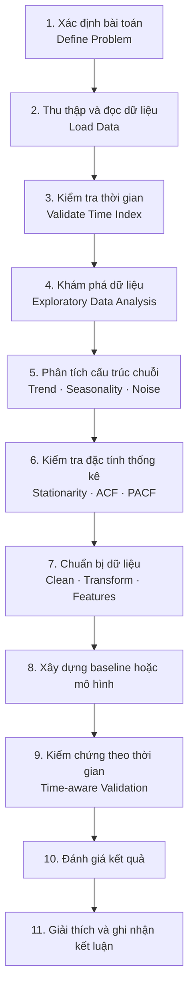

<div align="center">

# ⏱️ TOTAL LAB PRACTICE FOR TIME SERIES


<br/>


<br/>


</div>

---

# 📖 Giới thiệu

Repository này là nơi tập trung toàn bộ **bài thực hành Time Series (Chuỗi thời gian)** trong quá trình học, thử nghiệm và xây dựng nền tảng cho các bài toán dự báo.

Mục tiêu không chỉ là chạy được code, mà còn là hiểu đúng:

- dữ liệu chuỗi thời gian có gì khác dữ liệu thông thường;
- cách kiểm tra timestamp và tần suất;
- trend, seasonality, noise và stationarity;
- ACF, PACF và sự phụ thuộc theo thời gian;
- feature engineering không gây data leakage;
- cách chia train/validation/test đúng theo thời gian;
- cách xây dựng baseline và đánh giá mô hình forecasting.

> README này mô tả **toàn bộ repository**.  
> Mỗi Practice sẽ có tài liệu riêng cho mục tiêu, dữ liệu, quy trình, kết quả và kết luận chi tiết.

---

# 🎯 Mục tiêu học tập

<table>
  <tr>
    <td align="center" width="25%">
      <h3>🧠 Hiểu</h3>
      Hiểu bản chất dữ liệu chuỗi thời gian, timestamp, frequency, trend, seasonality và stationarity.
    </td>
    <td align="center" width="25%">
      <h3>🔍 Phân tích</h3>
      Sử dụng trực quan hóa, rolling statistics, decomposition, ACF và PACF để khám phá cấu trúc chuỗi.
    </td>
    <td align="center" width="25%">
      <h3>🛠️ Xây dựng</h3>
      Tạo feature, baseline và pipeline dự báo theo đúng thứ tự thời gian.
    </td>
    <td align="center" width="25%">
      <h3>📈 Đánh giá</h3>
      Đánh giá mô hình bằng time-aware validation và so sánh kết quả một cách trung thực.
    </td>
  </tr>
</table>

---

# 🗂️ Cấu trúc Repository

```text
TOTAL_LAB_PRACTICE_FOR_TIME_SERIES/
├── total_practice/
│   ├── Practice_1/
│   │   ├── datasets/
│   │   ├── notebooks/
│   │   ├── src/
│   │   ├── tests/
│   │   ├── outputs/
│   │   ├── docs/
│   │   ├── config/
│   │   ├── pyproject.toml
│   │   └── README.md
│   └── Practice_2/
├── references/
├── .agents/
├── AGENTS.md
├── working_rule.md
└── README.md
```

<table>
  <tr>
    <th align="left">Thành phần</th>
    <th align="left">Vai trò</th>
  </tr>
  <tr>
    <td><code>total_practice/</code></td>
    <td>Chứa toàn bộ các bài thực hành Time Series.</td>
  </tr>
  <tr>
    <td><code>Practice_n/</code></td>
    <td>Mỗi Practice là một bài học hoặc bài thực hành độc lập.</td>
  </tr>
  <tr>
    <td><code>references/</code></td>
    <td>Chứa tài liệu học tập và nguồn tham khảo dùng chung.</td>
  </tr>
  <tr>
    <td><code>.agents/</code></td>
    <td>Chứa rule, workflow và lịch sử quản trị dành cho AI agent hỗ trợ project.</td>
  </tr>
  <tr>
    <td><code>working_rule.md</code></td>
    <td>Tài liệu governance và nguyên tắc làm việc chung của repository.</td>
  </tr>
  <tr>
    <td><code>README.md</code></td>
    <td>Tổng quan toàn bộ repository.</td>
  </tr>
</table>

---

# 🧪 Các Practice

## Practice 1 — Khám phá đặc tính dữ liệu chuỗi thời gian

Practice 1 sử dụng dataset **AirPassengers**.

<table>
  <tr>
    <th align="left">Thuộc tính</th>
    <th align="left">Giá trị</th>
  </tr>
  <tr>
    <td>Dataset</td>
    <td><b>AirPassengers</b></td>
  </tr>
  <tr>
    <td>Tần suất</td>
    <td>Hàng tháng</td>
  </tr>
  <tr>
    <td>Seasonal period</td>
    <td><code>12</code></td>
  </tr>
  <tr>
    <td>Timestamp column</td>
    <td><code>month</code></td>
  </tr>
  <tr>
    <td>Target column</td>
    <td><code>passengers</code></td>
  </tr>
  <tr>
    <td>Khoảng thời gian</td>
    <td>1949–1960</td>
  </tr>
</table>

### Nội dung chính

- Kiểm tra timestamp và frequency.
- Trực quan hóa chuỗi thời gian.
- Rolling mean và rolling standard deviation.
- Kiểm tra stationarity.
- Phân tích ACF và PACF.
- Decomposition.
- Phân tích trend, seasonality và residual/noise.
- Chuẩn bị nền tảng cho feature engineering và forecasting.

---

# 🔄 Quy trình phân tích Time Series



---

# 🧠 Kiến thức trọng tâm

<table>
  <tr>
    <th align="left">Nhóm kiến thức</th>
    <th align="left">Nội dung</th>
  </tr>
  <tr>
    <td>🕒 Time Index</td>
    <td>Timestamp, frequency, chronological order, missing timestamps, regular/irregular series</td>
  </tr>
  <tr>
    <td>📈 Time-Series Structure</td>
    <td>Trend, seasonality, cyclic behavior, noise, stationarity</td>
  </tr>
  <tr>
    <td>🔗 Temporal Dependency</td>
    <td>Lag, autocorrelation, ACF, PACF</td>
  </tr>
  <tr>
    <td>🧩 Feature Engineering</td>
    <td>Lag features, rolling features, calendar features, seasonal features</td>
  </tr>
  <tr>
    <td>🧪 Evaluation</td>
    <td>Baseline, chronological split, validation strategy, forecasting metrics</td>
  </tr>
</table>

---

# 📊 Nguyên tắc dữ liệu

Quy trình dữ liệu tổng quát:

```text
Raw Data
   ↓
Validate
   ↓
Clean / Transform
   ↓
Processed Data
   ↓
Analysis / Modeling
```

Các nguyên tắc cần giữ:

- Không chỉnh sửa trực tiếp raw data nếu không cần thiết.
- Luôn giữ thứ tự thời gian.
- Kiểm tra missing timestamps và missing values.
- Không sử dụng thông tin tương lai để tạo feature cho quá khứ.
- Không shuffle dữ liệu Time Series tùy ý.
- Fit preprocessing chỉ trên dữ liệu training khi bước xử lý có thể gây leakage.

---

# 📏 Nguyên tắc thực nghiệm

Mỗi bài thực hành ưu tiên các nguyên tắc sau:

1. Hiểu bài toán trước khi code.
2. Lập kế hoạch trước implementation.
3. Thực hiện thay đổi nhỏ và có kiểm soát.
4. Chạy và verify sau mỗi thay đổi.
5. Xem output của AI là chưa đáng tin cho đến khi được kiểm chứng.
6. Không sử dụng code nếu chưa hiểu mục đích và vai trò của nó.
7. Xây dựng baseline trước khi thử mô hình phức tạp.
8. Không báo cáo kết quả chưa được tạo ra từ một lần chạy thực tế.
9. Đánh giá theo đúng thứ tự thời gian.
10. Kết luận phải dựa trên bằng chứng từ dữ liệu và kết quả thực nghiệm.

---

# 🧰 Công nghệ & Công cụ

<div align="center">

<table>
  <tr>
    <th>Nhóm</th>
    <th>Công nghệ</th>
  </tr>
  <tr>
    <td>Programming Language</td>
    <td>Python</td>
  </tr>
  <tr>
    <td>Data Processing</td>
    <td>NumPy, pandas</td>
  </tr>
  <tr>
    <td>Visualization</td>
    <td>Matplotlib</td>
  </tr>
  <tr>
    <td>Time Series Analysis</td>
    <td>statsmodels</td>
  </tr>
  <tr>
    <td>Machine Learning Utilities</td>
    <td>scikit-learn</td>
  </tr>
  <tr>
    <td>Notebook Environment</td>
    <td>Jupyter Notebook</td>
  </tr>
  <tr>
    <td>Version Control</td>
    <td>Git & GitHub</td>
  </tr>
  <tr>
    <td>Development Environment</td>
    <td>Visual Studio Code</td>
  </tr>
</table>

</div>

---

# 📌 Trạng thái hiện tại

<table>
  <tr>
    <th align="left">Practice</th>
    <th align="left">Trạng thái</th>
    <th align="left">Nội dung chính</th>
  </tr>
  <tr>
    <td>Practice 1</td>
    <td>🟡 Đang phát triển</td>
    <td>Khám phá đặc tính dữ liệu chuỗi thời gian</td>
  </tr>
  <tr>
    <td>Practice 2+</td>
    <td>⚪ Chưa bắt đầu</td>
    <td>Sẽ bổ sung theo lộ trình học</td>
  </tr>
</table>

---

# ✅ Kết quả mong đợi

Sau khi hoàn thành các Practice trong repository này, mục tiêu là có thể:

- hiểu và mô tả cấu trúc của một chuỗi thời gian;
- phân biệt trend, seasonality và noise;
- đánh giá tính dừng;
- giải thích ý nghĩa của lag, ACF và PACF;
- tạo feature đúng cho Time Series;
- tránh data leakage;
- chia dữ liệu theo thời gian;
- xây dựng baseline;
- huấn luyện và đánh giá mô hình forecasting;
- giải thích được vì sao một phương pháp hoặc mô hình được lựa chọn.

---

<div align="center">

### ⏱️ Understand the past — Model the pattern — Forecast the future

<br/>


**© 2026 TOTAL LAB PRACTICE FOR TIME SERIES**

</div>
